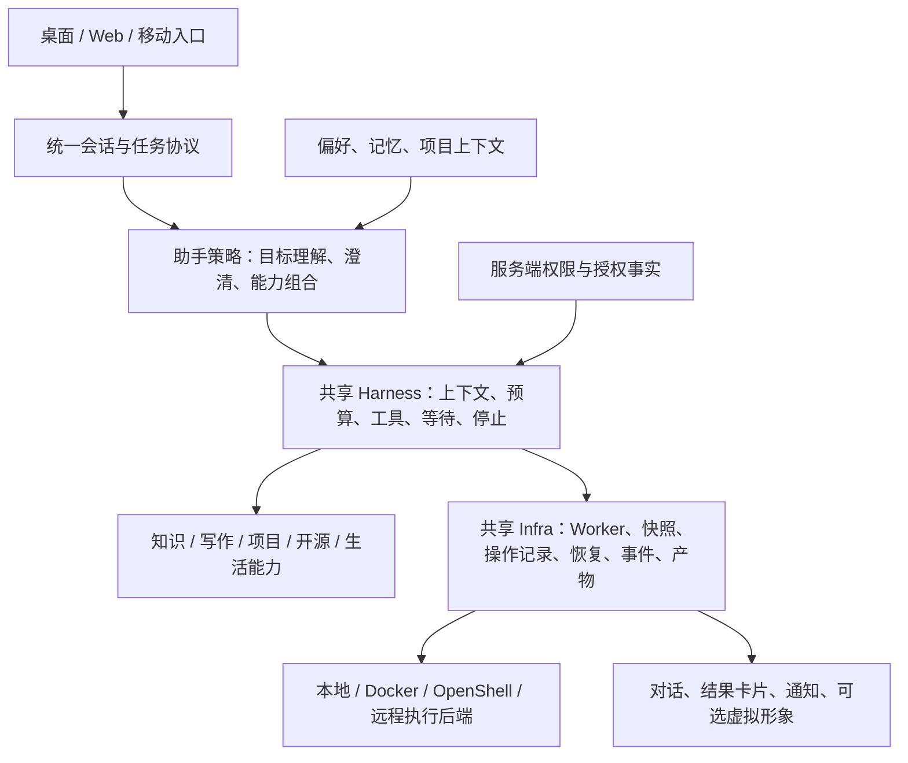

# 个人 AI 助手产品方向与架构讨论

讨论日期：2026-10-11；架构复核：2026-10-11。本文记录产品方向、技术取舍和阶段边界，供后续设计与实施参考。源码事实以当日检查和既有验收记录为依据；本次复核只调整未来设计，不将建议描述为已实现能力。

## 1. 讨论结论及决策状态

| 内容 | 状态 | 含义 |
| --- | --- | --- |
| 覆盖知识、开发、开源、生活的个人 AI 助手 | 用户明确方向 | 能力围绕同一个用户和目标协作，避免增加彼此独立的服务入口 |
| 进一步统一状态管理、Harness 与 Infra | 用户明确方向 | 保留状态分层，统一执行事实、上下文、预算和人工动作协议 |
| 第一期建设统一助手内核 | 用户明确优先级 | 先实现可验证的跨能力任务，再扩大产品交付形态 |
| 桌面优先、移动端作为随身入口 | 推荐方案 | 尚未选定桌面或移动框架、首发操作系统及远程连接方案 |
| 可以拥有自己的虚拟形象 | 用户明确产品可能性 | 可选表现层；具体形象、声音和渲染技术未确定 |
| 保留本地 shell，不能以缺少 Docker 阻止所有代码验证 | 用户明确要求 | 长期执行架构必须支持本地后端；第一期不实施真实宿主执行器 |
| 授权范围内自动回退，禁止静默扩大权限 | 推荐技术规则 | 首次授权与工作区信任机制由执行后端专项计划细化 |
| 长期 Task、可管理记忆、主动提醒 | 推荐演进方向 | 第一阶段不新增长期目标调度系统或记忆数据库 |
| 首期采用分级恢复 | 本次复核决策 | 公共 Run、工具操作和领域发布结果必须可核对；全领域内部模型调用精确重放按实际收益逐步增加 |

本文中的候选框架、接口和任务顺序是设计建议，不构成部署、数据库迁移、付费 Provider 调用或外部发布授权。

## 2. 当前项目处于哪一步

项目已经形成统一任务工作台，尚未形成完整的统一助手。

| 层次 | 当前已实现 | 差距 |
| --- | --- | --- |
| 前端 | 一个会话列表、输入框和时间线 | 仍要求选择 chat / knowledge / writing / code |
| 任务入口 | 公共提交、查询、事件和动作 API | `kind` 决定固定 Adapter，尚无一个 Run 跨能力编排 |
| Infra | 单 Worker、Run 生命周期、租约、fencing、持久化恢复基础 | 接入深度不同，恢复协议仍含代码专属假设 |
| Harness | 模型决策、工具策略、预算、上下文、持久化循环 | 聊天有独立 Runtime；RAG 和写作有独立编排及模型调用 |
| 个性化 | 会话保存、默认工作区和项目上下文 | 尚无完整偏好、可管理记忆、长期目标与权限体系 |
| 交付 | 本地 React Web + FastAPI | 无桌面安装升级、系统密钥管理及移动配对闭环 |

事实依据：

- [项目说明](/home/abeltomato/workspace/projects/Tomato-Agent/README.md)。
- [统一会话](/home/abeltomato/workspace/projects/Tomato-Agent/frontend/src/components/ConversationShell.tsx)。
- [任务分派](/home/abeltomato/workspace/projects/Tomato-Agent/backend/app/tasks/service.py)。
- [聊天 Runtime](/home/abeltomato/workspace/projects/Tomato-Agent/backend/app/agent/runtime.py)。
- [知识问答流程](/home/abeltomato/workspace/projects/Tomato-Agent/backend/app/knowledge/conversation.py)。
- [写作执行器](/home/abeltomato/workspace/projects/Tomato-Agent/backend/app/writing/executor.py)。
- [公共 Harness](/home/abeltomato/workspace/projects/Tomato-Agent/backend/app/agent/harness.py)。
- [快照与操作模型](/home/abeltomato/workspace/projects/Tomato-Agent/backend/app/execution/models.py)。

较早的 [Harness 与 Infra 路线图](/home/abeltomato/workspace/projects/Tomato-Agent/docs/实施计划/2026.09.26-Agent系统Harness与Infra演进路线图.md)面向工程展示，部分状态描述早于统一会话 MVP。当前事实应结合[统一会话 MVP 计划](/home/abeltomato/workspace/projects/Tomato-Agent/docs/实施计划/2026.10.11-统一会话与原目录代码任务MVP实施计划.md)与源码核对，不以较早描述覆盖后续成果。

## 3. 产品定位与典型任务

产品定位：本地优先、了解个人工作与生活上下文、可控制且可持续协作的 AI 助手。数据和执行控制可以留在本机，模型可以连接远程 Provider；本地优先不等于完全离线。

知识、开发、开源和生活是可组合的能力范围。用户通过自然语言提出目标，助手选择能力、请求必要澄清并展示执行依据。项目、知识库、日程与产物可以有专门视图，日常任务共用助手入口。

典型长期任务：寻找适合自己的开源 issue，结合技术栈分析，修改项目并验证，准备 PR 描述，记录进度并安排后续提醒。该任务涉及偏好、检索、项目执行、GitHub、写作和提醒，不应要求用户逐一切换服务分类。

第一期缩小到已有能力：结合知识库与当前项目完成修改、受控验证和解释；或者检索资料、确认提纲、生成并确认保存文章。GitHub 发布与提醒接入后续专项，不把长期示例作为第一期全部验收要求。首期先验证跨能力任务是否有用，再决定是否为长步骤建设更细的领域检查点。

## 4. 目标架构和职责

- 助手策略决定下一步建议，不拥有修改权限或任务完成判定权。
- Harness 管理模型与工具交互、共享预算、上下文和等待；领域能力可以保留自己的业务编排，但必须通过 Run 级模型计量、权限和完成判定，不得绕过公共控制。
- 领域能力保留证据、引用、版本、文件冲突、测试和产物校验。
- Infra 管理所有权、持久化、取消、恢复和结果发布；领域组件不能绕过 fencing 发布迟到成功。
- 执行后端报告实际约束能力，不能将普通宿主进程称为隔离沙箱。

只增加自动分类，再调用四个旧 Adapter，不能满足统一助手内核的交付目标。迁移可保留旧接口，但新入口要能在同一个 Run 内组合能力。

## 5. 状态机统一采用分层设计

| 对象 | 职责 | 第一阶段处理 |
| --- | --- | --- |
| Session | 交流上下文、会话历史和默认环境 | 复用已有实体，明确跨能力历史来源 |
| 长期 Task | 跨天目标、暂停与多次推进 | 后续设计；当前 API 的 task 仍主要表示 Run，不冒称已支持长期目标 |
| Run | 一次执行的 queued / running / waiting / completed / failed / cancelled / timed_out | 复用外层生命周期 |
| Attempt | 一次领取及其租约、fencing | 复用执行内核 |
| Operation / Step | 模型调用、检索、写入、验证的事实与重试边界 | 泛化快照和操作记录；已提交结果复用，未知副作用核对 |
| 领域状态 | 提纲确认、草稿保存、证据有效性、测试条件 | 保留业务校验，映射公共等待动作 |
| 资源状态 | 进程、容器、远程资源生命周期 | 与业务状态分离 |

统一的重点是执行事实来源、动作版本、上下文引用、恢复规则和事件协议，不是合并所有枚举。模型回答完成不等于代码验证通过，也不等于用户已经确认保存。

### 5.1 恢复保证分级

首期不把所有领域内部模型调用都强制转换为可逐调用精确重放。本项目先持久化会话、运行、工具调用、权限决定和领域发布事实，再对容易产生副作用的边界做幂等与核对；长步骤的内部重放需要额外冻结输入、检索结果、配置和版本，只有在中断成本证明其收益后再增加。

| 恢复等级 | 首期要求 | 适用范围 |
| --- | --- | --- |
| 公共 Run 恢复 | 必须保留状态、事件、租约、预算、取消和人工动作版本 | 所有助手任务 |
| 工具操作恢复 | 调用前预留、结果提交、已提交结果复用；未知副作用等待核对 | 检索、读取、写入、测试和产物 |
| 领域发布恢复 | 按领域 ID、版本和幂等键观察，不重复发布 | 提纲确认、草稿保存等业务副作用 |
| 领域内部模型重放 | 首期统一计量，通过已提交公共工具结果或已发布领域结果复用；未发布生成按安全规则开始新尝试并记录输入/配置变化，不按 ordinal 复用子响应 | 长步骤模型编排，后续按证据增强 |

首期新增助手 Run 的工作区绑定规则为：无工作区任务可以先做聊天、知识和澄清；尚未发生项目操作时，用户可通过类型化服务端动作绑定一个已注册工作区一次，任何项目读取、写入或验证都要求已绑定。绑定后固定到 Run，不允许从模型文本静默改变。权限拒绝反馈策略并禁止绕过，执行所有权失效时旧 Attempt 停止提交、由有效 lease 恢复，未知副作用进入 waiting 并核对。

共享预算的事实源仍是 Run 级 ledger。顶层策略和领域生成器都必须使用同一个网关，调用次数、剩余时间和取消信号由外层 Run 传递；单次有效超时取服务端上限与 Run 剩余活动时间的较小值。等待期间不消耗活动执行时间，已经消耗的预算不清零，恢复对在途时间保守结算。工具失败区分业务/测试失败、权限拒绝、配置不可用、所有权失效和未知结果：失败可在预算内修复；拒绝后可选择授权内替代；不可用不能标验证通过；所有权失效不能提交；未知副作用先核对。

### 5.2 同类工具的工程参照

以下公开实现用于验证工程边界，不作为本项目必须复制的框架：

- [OpenClaw Agent loop](https://github.com/openclaw/openclaw/blob/main/docs/concepts/agent-loop.md) 将会话入口、按会话串行的 Run、模型/工具循环、事件流和终态等待分开；这支持本项目保留 Session、Run、Harness 和 Presentation 的边界。
- [nanobot AgentRunner](https://github.com/HKUDS/nanobot/blob/main/nanobot/agent/runner.py) 在执行工具前记录待执行调用，工具完成后保存结果和检查点；这支持先持久化操作事实，再处理恢复，而不是对整条流程使用通用 retry。
- [Cline 权限处理](https://github.com/cline/cline/blob/main/docs/sdk/guides/permission-handling.mdx) 将工具启用、自动批准和人工批准分开；这支持服务端权限独立于表达偏好。
- [Cline 持久化服务](https://github.com/cline/cline/blob/main/sdk/packages/core/src/session/services/persistence-service.ts) 会核对失去进程的活动会话并明确标记失败；这说明可解释停止是成熟工具的正常选项，不要求所有运行都精确续跑。
- [OpenHands 架构](https://github.com/OpenHands/OpenHands/blob/main/docs/architecture.md) 将前端、Agent Server、执行环境和自动化后端分层，并明确宿主运行与隔离运行的差异；这支持本项目继续独立设计 ExecutionBackend。

这些参照证明的是职责划分和风险处理方式，不证明某一种数据库、编排框架或精确恢复方案适合本项目。GitHub 研究结果必须结合本地用户任务、实际中断成本和可验收证据决定。

## 6. 个性化、权限和主动性

个性化分为明确偏好、长期记忆、环境上下文。长期记忆应具有来源、用户确认状态和查看/编辑/删除能力；会话历史不得全部自动变成永久事实。

权限独立管理：交流风格与“少问确认”的偏好不能授权文件删除、任意命令、外部发布或付款。用户授权的工作区与能力范围内可以自动执行，扩大权限时再询问。

主动性按顺序发展：用户创建的提醒和定时任务 → 建议型提醒 → 长期目标协作。所有主动任务需要可查看的触发条件、权限、预算与停止方式。生活能力首批候选为笔记、待办、提醒和日历。

## 7. 本地 shell 与执行后端

### 7.1 明确接受本地执行方向

本地执行是一等后端，也可以作为已授权回退路径。可信项目已有虚拟环境、Node 环境和构建工具时，本地验证更接近实际使用环境。Docker 缺失不能成为长期产品阻止所有验证的理由。

当前 [LocalSandboxExecutor](/home/abeltomato/workspace/projects/Tomato-Agent/backend/app/agent/sandbox.py)只有注入后端契约，默认拒绝请求；它不是实际宿主 shell 执行器。当前原目录测试仍要求 Docker。本地执行需要新增真实后端、授权契约和故障验证，不能仅修改配置名称或允许 `allow_process`。

建议将通用契约提升为 ExecutionBackend：

| 后端 | 适用场景 | 必须说明的边界 |
| --- | --- | --- |
| 本地进程 / shell | 自有可信项目、已有开发依赖 | 当前用户权限；cwd、白名单、venv 不提供容器级隔离 |
| Docker / OpenShell | 需要隔离或固定环境 | 文件、网络、资源约束及实际验证范围 |
| 远程执行器 | 手机发起、桌面离线、专用环境 | 身份、连接、远程权限与资源归属 |

固定命令优先 argv 直接启动进程，只有确需管道、重定向或脚本语义时使用 shell。命令审查不能代替测试代码自身的信任判断。

### 7.2 回退原则

| 触发情况 | 建议规则 |
| --- | --- |
| 启动前确认 Docker 缺失或 daemon 不可用 | 工作区已授权本地执行则选择本地；否则请求授权 |
| 容器缺依赖 | 提议改用本地，作为不同环境的新验证尝试 |
| 测试正常运行但失败 | 保留失败；不能将切后端当作抹除失败的机制 |
| 策略拒绝 | 不自动降级权限绕过拒绝 |
| 执行已开始但超时、断连或结果未知 | 先核对原操作，不能直接在另一后端重复执行 |

报告需保存后端、命令、工作目录、环境标识、退出码、验证范围、输出截断和回退原因。环境变化不能静默发生。

### 7.3 实现本地后端前的工程要求

- 不默认继承助手 Provider 密钥；环境变量按项目需求显式传入。
- 管理进程树、超时、取消、退出及重启后的遗留进程；不把取消等同回滚。
- 有界采集 stdout / stderr；日志不记录密钥或敏感配置。
- 测试可以产生缓存、覆盖率和构建文件，需定义允许输出与意外变更，而非要求项目所有文件完全不变。
- 真实本地后端单独验收可信项目成功、失败、超时、子进程、取消、依赖缺失和未知结果。
- 第一期建设助手与验证后端的能力边界，不实现本地执行或伪造回退成功。

## 8. 桌面、移动和虚拟形象

桌面可复用 React + Python。Tauri + Python 是偏轻量的候选，Electron + Python 是偏 Web 生态与快速交付的候选。尚未做打包实验，不能宣称跨平台交付已可用。

桌面专项必须涵盖：后端启动/健康/退出、用户数据目录、系统密钥存储、本地 API 认证、窗口与后台任务关系、休眠恢复、升级迁移和备份。仅监听 loopback 不等于已经认证。

移动端推荐先做响应式 Web / PWA 验证随身使用价值，再根据推送、语音、相机和系统分享需求选择 App 技术。移动端主要收集素材、查看任务与确认，执行交给桌面或远程后端。远程访问必须设计设备配对、认证、加密连接、去重及离线行为，不能直接暴露当前可信单用户 API。

虚拟形象是同一助手的可选表现层，优先静态头像、少量状态动画和可关闭悬浮入口，再考虑语音、Live2D 或 3D。表现由真实事件驱动：执行、等待、失败、完成不允许用持续“思考”动画掩盖。人格设置影响表达，不改变记忆事实、授权和执行状态。

## 9. 阶段顺序与风险

| 顺序 | 目标 | 完成依据 |
| --- | --- | --- |
| 1 | 统一助手最小闭环 | 自然语言入口；同 Run 跨能力执行；共享预算、等待、取消和分级恢复；真实任务证明有用 |
| 2 | 本地执行后端专项 | 授权与回退明确；真实进程故障测试；报告记录环境 |
| 3 | 桌面 MVP | 无需开发终端即可启动使用；数据与密钥管理；可选轻量形象 |
| 4 | 开源与生活闭环 | 发布授权、笔记与提醒接入统一能力体系 |
| 5 | 长期记忆和移动伴随端 | 可管理记忆；跨设备、断线和离线行为可解释 |

桌面打包可行性验证可以提前穿插，阶段不等同日历承诺。首发系统、主动性程度、语音与形象技术、远程连接方式在对应专项明确。

关键风险：只做分类包装；领域内模型调用绕过预算；恢复等级过度设计而无法交付；工作区在澄清时绑定不清；测试失败被误报成功；未知副作用重复执行；旧历史重复或丢失；个性化误作授权；本地执行误称沙箱；追求平台和形象功能导致首期无法验收。对应控制写入[第一期实施计划](/home/abeltomato/workspace/projects/Tomato-Agent/docs/实施计划/2026.10.11-统一助手内核第一期实施计划.md)。