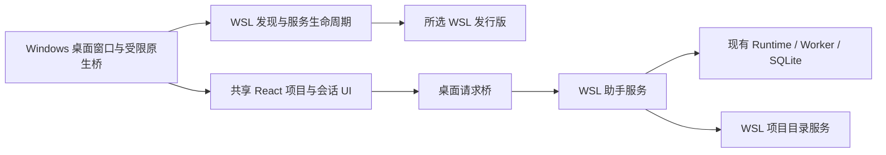

# Windows 桌面 MVP 与 WSL 项目体验实施计划（计划日期：2026-10-18）

> **状态：任务1、2及切片3、4、5 DONE；整体任务3 DONE（Windows 实机人工 UI 验收于 2026-10-20 由用户确认完成）。** 切片3后端直接目标组55项通过；切片4标题/项目关联既有后端目标测试4项通过；切片5前端目标测试29项、后端直接相关测试38项及前端生产构建通过。真实模型请求未执行，不属于桌面 UI 人工验收结论。计划与日志继续忽略，工程验证及边界见桌面连接与生命周期文档。

## 1. 目标与交付边界

交付可在 Windows 实机启动的桌面初版，连接本机 WSL 中的助手服务，提供可理解的项目和会话界面。用户无需分别启动 Vite 与 uvicorn，即可选择 WSL 环境、打开或新建项目、发起助手任务，并在重开应用后恢复项目和会话。

首期为 **Windows 客户端 + 已准备好的 WSL 后端运行环境**。不是无需 WSL 的独立 Windows 后端安装包。原生 Windows 执行、Linux 桌面、Android、远程主机、跨设备同步、推送、自动升级、虚拟形象和联网搜索不纳入本期。

“新建项目”仅创建用户选择父目录中的一个子目录并登记项目，不初始化 Git、不安装依赖、不自动生成代码。代码修改和测试能力继续遵循已有能力边界；桌面化不代表统一助手已获得任意 shell 或跨能力写作/修改能力。

### 1.1 首期验收流程

双击 Windows 应用 → 选择已安装且已准备后端的 WSL 发行版 → 应用启动或连接助手服务 → 浏览该环境目录 → 打开文件夹或新建项目 → 新建会话 → 自动生成可辨识标题 → 完成一次助手任务 → 关闭并重新打开 → 项目、标题和任务结果仍正确。

### 1.2 当前依据

- `README.md`
- `docs/architecture/个人AI助手产品方向与架构讨论.md`
- `docs/guides/环境配置说明.md`
- `docs/guides/本地开发指南.md`
- `docs/acceptance/真实Provider本地UI验收.md`
- `frontend/src/components/ConversationShell.tsx`
- `frontend/src/components/WorkspacePicker.tsx`
- `backend/app/api/sessions.py`
- `backend/app/api/workspaces.py`
- `backend/app/workspaces/service.py`
- `backend/app/execution/ports.py`

Codex 交互是产品参考，不作为已核实的内部实现依据；前期官方页面请求 403，GitHub 原始内容请求超时。

## 2. 已知现状与技术决策门禁

当前开发环境为 WSL2，已发现 Linux Rust/Cargo、Node 22、pnpm 10.34.5、Python 后端虚拟环境，以及 Windows PowerShell 和 wsl.exe。未验证 Windows Rust/MSVC、WebView2、桌面框架或 Windows 安装包构建。仓库没有桌面工程。

候选采用 Tauri 2 + 现有 React/TypeScript + WSL Python/FastAPI；**Tauri 尚未正式锁定**。切片 1 验证 Windows 构建与 WSL 连接成功后才批准继续。无法验证时明确阻塞，不用 Linux 构建或浏览器页面替代 Windows 桌面验收，不自动转用 Electron。

新增框架及构建依赖须在仓库清单中声明并锁定，先核对官方安装要求。不得自动安装全局工具、修改系统设置、启用 WSL 或执行系统提权。缺少工具时报告具体缺项；安装与环境变更另获明确授权。

## 3. 架构与职责



- 客户端、助手服务和执行环境概念分离；本期助手服务和文件操作同处所选 WSL 环境，不提前拆成远程执行集群。
- WSL 路径只由对应 WSL 服务解释；不用 Windows 路径或 `\\wsl.localhost` 访问替代 WSL 文件/进程语义。
- 第一版一次连接一个后端实例。切换发行版等于切换数据源，界面明确提示会话不会自动搬迁；不暗示已有跨环境同步。
- `environment_id` 标识发行版连接，`service_instance_id` 标识服务数据归属；同一台机器的两个发行版同路径不是同一项目。
- 运行中的 Run 固定环境，不静默迁移、不因断线自动重复提交、不在另一发行版重放未知操作。
- 继续复用 Run、事件、快照、租约和操作账本，不另建桌面任务状态机。

### 3.1 桌面连接和生命周期

原生桥只提供发现发行版、连接/启动服务、检查连接、受控关闭等固定命令，前端不能传入任意 shell 文本。使用 `wsl.exe` 的独立 argv 参数选择发行版和固定启动模块；后端目录、Python 路径及参数均校验，避免 shell 插值。

首次设置允许在“高级连接设置”中选择已有 WSL 后端安装位置，检测 `.venv/bin/python` 与后端模块；日常项目流程不出现安装目录字段。首期不自动向发行版部署代码或安装依赖。

启动返回端口、协议版本、实例身份及一次性连接信息，进程日志不输出凭据。仅接受本机连接；Windows 到 WSL 的实际可达地址必须实机探测，不将 WSL 内监听 loopback 直接等同于 Windows 可访问。禁止为解决连接问题自动绑定 `0.0.0.0` 或修改防火墙。

桌面凭据由原生层持有，不放 localStorage、前端构建变量或 URL。桌面请求经原生桥附加连接凭据；后端认证覆盖目录、会话、任务和模型设置全部桌面 API，错误实例或失效凭据拒绝。Web 开发模式保持显式隔离，不因桌面接入增加通配 CORS。

默认关闭窗口即退出客户端；若有进行中的任务，提示“保留后台任务并退出”或“返回应用”，不把关闭窗口解释为取消。显式取消走既有任务动作。仅在服务由本应用启动、无活动任务且无其他连接时允许受控关闭；已存在服务不擅自终止，不使用 `wsl --shutdown`。进程所有权或操作结果未知时保留现场并提示核查。

### 3.2 项目与目录

项目记录至少包含 `project_id`、显示名称、`environment_id`、`service_instance_id`、规范化根目录、关联 `workspace_id`、创建/更新时间与可用状态。展示名称默认取文件夹名，完整目录放详情中。

目录浏览仅返回子目录和必要元信息；分页有界，默认隐藏系统/隐藏目录，可显式显示。路径解析和符号链接核对在服务端执行，不允许借链接或 `..` 越过已批准根范围。

浏览授权与项目操作授权分开：首次选择可浏览的 WSL 用户目录范围；“打开此文件夹”后对确切项目根进行信任确认并持久化。不得开放 `/`、自动将整个 home 设为可写项目根，或让模型自行扩大批准目录。选择文件夹不自动授予 shell 执行权限。

“新建项目”接收已批准父目录与单个目录名；拒绝绝对名称、路径分隔符、`.`、`..` 和既有同名对象，不覆盖原目录。目录创建成功但数据库登记失败时保留并报告实际路径，重试先核对，不自动删除目录。

项目打开不要求 Python 或 pytest。现有 workspace 注册与 pytest 路径校验需要解耦：无测试配置的项目支持读取；已有代码任务只有在有效测试 profile 可用时才运行测试，不注入虚假的 `tests` 路径，不改变旧 API 的默认安全语义。

### 3.3 会话标题

沿用会话 UUID 作为内部主键，新增有界标题、来源（临时/模型/手动）、版本和生成状态。兼容已有 `metadata.title`，老会话无标题显示“未命名对话”，不再直接以 UUID 作为名称。

第一条真实用户任务持久化后生成临时标题；用户输入中不包含可见文本时使用“新对话”。后台模型调用以首条输入和可用首轮结果生成不超过 30 个字符的单行标题，不把完整项目文件或无限历史发给标题模型。人工重命名后，迟到模型结果必须通过版本检查被拒绝。

标题调用使用独立、可观测的辅助任务：每会话一个幂等生成任务，一次请求、30 秒超时、不自动重试；失败保留临时标题。记录用量，不占用或重置业务 Run ledger，不影响主任务终态。默认可关闭；开启后告知存在辅助模型请求，真实验证仍需具体预算授权。支持手动重命名且不再自动覆盖。

### 3.4 数据与配置

Windows 仅保存窗口、连接和项目导航偏好；会话、Run、RAG、标题和项目事实保存在对应 WSL 服务。首期复用已准备后端的数据位置，不自动移动或覆盖业务数据库；数据库增量仅添加兼容字段/表，不删除旧数据。

模型设置采用桌面专用配置与凭据接口：显示模型、端点和“已设置密钥”状态，接口不回传完整密钥。持久密钥由 Windows 系统凭据存储托管，通过受控连接注入所选 WSL 服务，禁止传在命令行参数或日志中；此接线需在切片 1 验证可行性。不覆盖已有 `.env`，桌面配置与环境变量优先级明确展示。不能安全接线时该切片保持阻塞，不退化为浏览器明文永久存储。

## 4. 文件职责规划

以下为拟新增/修改位置；执行时先核对实际签名，目录均相对本仓库的绝对根 ``。

| 绝对路径 | 责任 |
| --- | --- |
| `desktop/` | Windows 桌面工程、原生桥、Windows 构建配置及原生测试；切片 1 通过后确定内部结构 |
| `backend/app/desktop/` | 固定启动入口、服务身份、连接认证和安全设置接线 |
| `backend/app/projects/` | 项目记录、目录浏览、信任和新建目录服务 |
| `backend/app/api/projects.py` | 项目与目录 HTTP 契约 |
| `backend/app/sessions/titles.py` | 标题辅助任务、幂等及人工标题版本门禁 |
| `backend/app/sessions/repository.py` | 标题与项目关联的兼容持久化 |
| `backend/app/api/sessions.py` | 标题更新和会话项目关联 API |
| `backend/app/workspaces/service.py` | 目录登记与测试 profile 解耦，兼容旧代码任务 |
| `backend/app/application.py` | 桌面模式 API 接线，保持普通 Web 启动兼容 |
| `frontend/src/platform/` | Web/desktop 传输适配，不在 UI 组件直接调用 wsl.exe |
| `frontend/src/components/ProjectSidebar.tsx` | 项目和会话分组导航 |
| `frontend/src/components/ProjectDialog.tsx` | 浏览、打开与新建项目 |
| `frontend/src/components/ConnectionSettings.tsx` | WSL 服务与模型连接设置 |
| `frontend/src/components/ConversationShell.tsx` | 复用任务交互，接入项目/标题；仅按职责抽取直接相关部分 |
| `frontend/src/components/WorkspacePicker.tsx` | 从日常入口移出底层注册表单，保留必要兼容入口 |
| `frontend/src/api.ts` | 新契约和平台传输接线 |

## 5. 实施切片与门禁

所有复选框初始未完成。每个切片先读取目标实现/测试，按测试意图增加失败覆盖，再实现及验证；前一门禁未通过不推进依赖切片。

### 切片 1：Windows 桌面技术与 WSL 连接验证

- [x] 只读检查 Windows Rust/MSVC、WebView2、Node/pnpm、WSL 发行版、后端解释器与网络模式，输出缺项；不自动安装。Windows Rust/Cargo 未发现，Windows pnpm 11.3.0 与项目 10.34.5 不一致；完整版本与检查边界见技术验证文档。
- [x] 经实施授权后，在仓库内声明 Tauri 2 依赖并创建最小桌面工程，复用现有前端构建产物。工程位于 `desktop`，包含 pnpm/Cargo lock。
- [x] 建立固定 argv 的发行版发现/后端启动接口，校验发行版、路径和服务身份；凭据通过受控通道传递。启动隔离 `app.desktop.probe`，非业务服务生命周期实现。
- [x] 原生单元测试覆盖带空格/非 ASCII 路径、恶意发行版字符串、未知协议、启动失败、端口被其他实例占用、令牌缺失/错误以及日志脱敏。
- [x] 在 Windows 实机完成窗口启动、WSL 服务连接、健康及身份请求、原生凭据存取验证；不发真实模型请求。
- [x] 在 Windows 工具链生成并启动可分发构建产物，记录 Windows/WSL/WebView2/编译器版本、命令、架构和产物 SHA-256。

21:36检查点：Windows原生7、后端4、桌面UI桥1、Web会话17测试通过；release exe已生成并实机启动，原生报告与UI点击确认认证/身份/目录及凭据往返。原生测试覆盖实例拒绝，但尚未真实绑定冲突端口；自动化窗口证据不替代后续人工检查。NSIS官方插件下载超时，安装包项保持未完成。完整证据、指纹与恢复条件见技术验证文档。

21:43最终检查点：用户提供官方插件，经官方源码SHA-1核验，修正additional缓存路径；9/9原生测试通过，NSIS构建和安装退出码0，安装后应用实机UI验证通过。任务1完成；21:36阻塞记录为历史，不再是当前状态。

**门禁：** Windows 可运行构建 + 认证连接 + 目录/凭据桥可行性均有实际证据；否则停在技术验证，不将候选框架视为已确定。

### 切片 2：桌面服务生命周期与认证

- [x] 新增 `backend/tests/test_desktop_connection.py`、`test_desktop_lifecycle.py`，覆盖无凭据拒绝、身份不符、启动幂等、失联重连、重复窗口及自有/外部进程区分。
- [x] 实现本期单服务连接、状态机 `disconnected/connecting/ready/error`；连接错误使用用户可理解的说明和可展开详情。
- [x] 服务启动有超时；启动失败不自动循环重试。重连先查询原任务，不重发提交。
- [x] 活动任务退出保留后台，重开从服务恢复；空闲自有服务按受控接口退出，外部服务不结束。
- [x] API/SQLite 集成测试验证已完成、等待和运行中任务在客户端断开后事实不被清除；本期不承诺 WSL 关机后自动接管所有任务。

**门禁：** 认证、身份、所有权和关闭行为均可测，普通 Web 模式及既有任务语义未被破坏。

### 切片 3：项目、目录选择与测试配置解耦

- [x] 新增 `backend/tests/test_projects.py` 和 `test_projects_api.py`，覆盖目录浏览、打开幂等、新建冲突、名称非法、越界、符号链接、目录消失、权限不足和目录/数据库双写失败。
- [x] 实现环境/实例/根目录关联的项目记录及信任范围，添加服务端目录浏览与新建接口。
- [x] 将现有 workspace 登记和 pytest profile 分离；保持已有原目录代码 API 有效，无配置项目不能宣称测试可执行。
- [x] 扩展 `backend/tests/test_original_workspaces.py`、`test_project_test_targets.py` 和 `test_assistant_project.py`，覆盖无 pytest 的普通目录读取、显式配置测试后的旧行为以及拒绝绕过。
- [x] API → SQLite → 真实临时文件系统集成验证：创建项目、重启服务、再次打开同项目，身份不重复且内容不被覆盖。

2026-10-19 工程检查点：后端目标组合55 passed；测试覆盖新旧 workspace profile、信任根边界、隐藏/链接目录过滤、分页上限、冲突不覆盖、数据库失败保留目录、既有测试 profile 不变、环境/实例身份隔离及 SQLite 重启幂等。WSL 原生连接桥将发行版名经 stdin 传入，`.desktop-instance` 绑定项目身份。Windows 原生目标测试尚待在 Windows 工具链执行；桌面 UI 与真实 Windows 项目验收保留后续切片，不视为本轮通过。

**门禁：** 项目与测试配置解耦，路径由 WSL 服务解释，原安全边界不因 UI 简化而放宽。

### 切片 4：会话标题与项目关联

- [x] 新增 `backend/tests/test_session_titles.py`，覆盖临时标题、模型成功/超时/空值/超长/多行、重复任务、迟到响应、人工覆盖及不同会话隔离。
- [x] 实现 title/source/version/status 的兼容存储和人工重命名 API，兼容旧 metadata.title；项目关联不改动既有 Run 环境。
- [x] 实现一次请求、30 秒超时的辅助标题任务，默认关闭；fake Provider 验证不影响主 Run 状态与预算。
- [x] 扩展 `backend/tests/test_session_task_history.py` 和 `test_unified_tasks_api.py`，覆盖首条请求幂等、标题变化后的历史查询、重启恢复及项目归属。
- [x] 集成测试验证标题生成时用户改名，迟到模型响应不能覆盖，失效连接不能修改另一服务会话。

**门禁：** UUID 不再作为主要名称，手动命名稳定，标题失败不影响业务回答。

### 切片 5：日常项目与对话界面

- [x] 新增 `/frontend/tests/project-sidebar.test.mjs`、`project-dialog.test.mjs`、`connection-settings.test.mjs`，遵循现有 node:test 模式，不因测试擅自增加 UI 框架。
- [x] 项目侧边栏展示名称和 WSL 环境，按项目组织标题化会话，保留独立对话区。
- [x] 实现“打开文件夹/新建项目”两条流程；目录属于 WSL 时使用环境内浏览器，不错误套用 Windows 原生路径。
- [x] pytest、绝对路径输入、workspace/session UUID 移至高级设置或详情；配置不可用时显示实际限制，不显示不存在的执行能力。
- [x] 更新现有 conversation-shell 和 API 测试，覆盖首次启动、切服务数据源、重命名、项目不可用、错误与恢复，保留既有等待/取消行为。
- [x] 桌面原生 API 通过平台 adapter 使用；Web 模式保留可运行入口，模型凭据不进入浏览器存储。
- [ ] 真实 Windows UI 人工检查：首次启动、目录选择、项目创建、首轮标题、刷新/重开、模型设置及失联提示；截图同时记录环境和批次。当前没有满足此项的实机观察记录。

**门禁：** 日常路径不要求理解后端目录、pytest 和内部身份，真实状态及错误仍可追溯。工程测试通过但真实 Windows UI 人工检查未完成，切片5保持待验收。

### 切片 6：配置、安装包与交付

- [ ] 实现 WSL/模型设置及安全凭据持久化，测试空配置、无效模型、认证失败、旧 .env 优先级提示、取消设置与清空凭据；不在普通保存操作中自动调用 Provider。
- [ ] 完成 Windows 构建配置及产物安装/启动验证；首期未签名时明确标识，不承诺消除 SmartScreen，不自动绕过系统保护。
- [ ] 更新 README、本地开发指南和环境配置说明，新增 `/docs/Windows桌面端使用说明.md`，写明 WSL/Python 前提、配置、启动、退出、数据归属、备份及恢复。
- [ ] 运行直接受影响后端/前端回归、Windows 原生测试和构建；仅当回归暴露公共影响时扩大范围，不默认全仓测试。
- [ ] 经单独费用授权执行 1 个真实业务 Run，并另行明确是否允许 1 次标题辅助请求；预算分开记录，不把旧验收授权继承为新请求额度。
- [ ] 完成下节实机矩阵，保存报告、截图、版本、命令和产物指纹；开发日志及时追加，计划状态按实际证据更新。

## 6. 验证执行约定

后端所有命令工作目录为 `backend`，使用 `./.venv/bin/python`。新增测试文件须在对应切片创建后才运行，示例：

```bash
./.venv/bin/python -m pytest tests/test_desktop_connection.py tests/test_desktop_lifecycle.py -q
./.venv/bin/python -m pytest tests/test_projects.py tests/test_projects_api.py tests/test_original_workspaces.py tests/test_project_test_targets.py tests/test_assistant_project.py -q
./.venv/bin/python -m pytest tests/test_session_titles.py tests/test_session_task_history.py tests/test_unified_tasks_api.py -q
```

前端工作目录为 `frontend`：

```bash
node --test tests/project-sidebar.test.mjs tests/project-dialog.test.mjs tests/connection-settings.test.mjs tests/conversation-shell.test.mjs tests/unified-task-api.test.mjs
pnpm build
```

桌面测试与构建命令在切片 1 确认工程根、Windows 工具链及依赖版本后写入桌面 package/Cargo scripts，并回填本计划。不得把尚不存在的脚本当作已可执行命令。Tauri 原生测试、Windows 构建/安装均在 Windows 执行；WSL Rust 测试只能证明对应平台编译和逻辑，不替代 Windows 门禁。

真实模型使用独立验收数据。后端测试不写业务库；RAG 语料/向量库放 `backend/data/rag/databases/`，RAG 实验报告放 `backend/data/rag/reports/`；非 RAG 桌面验收工件放 `backend/data/desktop-acceptance/<批次>/`，Windows 原生产物可放 Windows 本地应用构建目录并在报告记录绝对路径。敏感配置、数据库和录制不得加入 Git。

## 7. Windows 实机验收矩阵

| 场景 | 必须观察到的结果 |
| --- | --- |
| 首次启动，无 WSL/发行版 | 明确提示缺项，不安装、不死循环、不发模型请求 |
| 发行版存在，后端路径无效 | 指向高级连接设置，错误不泄漏密钥 |
| 正常启动与再次启动 | 连接正确实例，不重复服务/Worker、不混用数据库 |
| 选择 WSL 目录 | 显示正确发行版与项目名，文件操作确实位于该发行版 |
| 打开非 Python 项目 | 可聊天/读取，未配置测试不伪装可运行 pytest |
| 新建项目，中文/空格目录名 | 仅创建指定子目录，重复名称不覆盖 |
| 链接越界、拒绝信任 | 服务端拒绝；模型不能通过其他工具绕过 |
| 普通聊天无项目 | 能正常提交，不强制选择文件夹 |
| 标题生成与人工改名 | 临时标题立即显示，自动标题持久化且不覆盖手动标题 |
| 模型错误与标题错误 | 业务/辅助错误区分；标题失败不导致业务任务失败 |
| 等待输入时退出再开 | 同 Run 等待动作仍可用，不提交替代任务 |
| 任务执行时断开或关窗 | 保留后台任务，重连查询事实；不把断连当取消或重发 |
| WSL 停止或服务崩溃 | 显示连接失效；未知结果不宣称成功或自动重放 |
| 退出应用，已有外部服务 | 不终止非本应用拥有的进程 |
| Windows 安装/启动产物 | 在记录版本环境中可启动，不依赖正在运行的 Vite 开发服务器 |

## 8. 风险与处理

| 风险 | 处理与停止条件 |
| --- | --- |
| Windows 构建依赖缺失 | 记录缺项等待授权，不自动全局安装；切片 1 未通过不启动后续实现 |
| WSL 网络模式差异 | 实机探测连接及身份；不能安全直连时停下设计受控隧道，不开放公网监听 |
| 原生凭据到 WSL 的安全传递 | 单独验证受控通道、生命周期与脱敏，失败时保持配置切片阻塞 |
| 目录选择被误解为任意执行授权 | 浏览、项目读取/修改、命令执行分开校验，后两者沿用现有权限 |
| 项目抽象与旧 workspace 冲突 | 兼容现有 workspace_id，通过适配关联，不批量重写旧任务 |
| 标题请求增加费用或覆盖人工命名 | 显式开关、一次请求、独立计量、版本门禁，不自动补跑 |
| 多环境数据混淆 | 本期一次连接一个数据源，显式标注，不做会话自动迁移或数据库同步 |
| 为桌面交付扩大 Runtime 冻结范围 | 只增客户端/连接/项目/标题能力，通用副作用、本地 shell 等单独立项 |

## 9. 执行检查点

| 切片 | 状态 | 完成证据 |
| --- | --- | --- |
| 1 Windows 技术验证 | DONE（21:43） | 原生9/9含真实冲突端口与脱敏；NSIS构建/安装退出码0、安装后窗口UI认证与目录/凭据桥通过；版本和产物指纹见技术验证文档 |
| 2 连接认证与生命周期 | DONE（22:10） | 后端64、前端23、Windows原生12通过；双客户端和窗口受控退出实机通过；NSIS最终退出码0；详见Windows桌面连接与生命周期.md |
| 3 项目与目录服务 | 待执行 | 无 |
| 4 会话标题与关联 | 待执行 | 无 |
| 5 项目与对话界面 | 待执行 | 无 |
| 6 配置、产物与交付 | 待执行 | 无 |

2026-10-18 用户追加批准安装依赖后恢复任务1，已安装Windows Rust并验证最小工程；当前因NSIS官方下载超时再次停止。未调用真实模型，隔离探针不访问业务库，不改防火墙或执行策略。实施使用主工作树；计划和日志保持Git忽略，用户已授权的本次commit仅纳入工程、目标测试和可跟踪文档。

2026-10-18 21:43恢复结果：NSIS下载阻塞已解除，任务1全部检查项完成；本次commit纳入补充原生测试与可跟踪文档，忽略的计划/日志不提交。

2026-10-18 22:10任务2完成：固定bootstrap单实例入口、全路由认证、原生请求桥、显式重连和所有权关闭；修复Windows排除端口及Tauri事件权限。工件位于backend/data/desktop-acceptance/task2-20261018，独立数据库且无真实模型请求。异常丢失连接保守阻止关闭，不继承外部服务所有权；任务2未重新安装产物，未扩展WSL关机接管。同步README、desktop/README和可跟踪生命周期说明，用户授权commit不含计划/日志。
