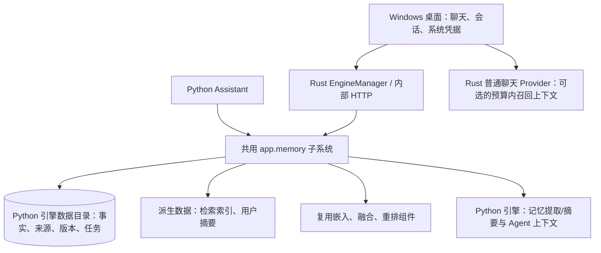

# 个人助手长期记忆系统实施计划

计划日期：2026-11-09；架构复核：2026-11-10。状态：**实施中（T6c 已完成；T7 Windows 隔离交互、记忆治理、故障降级/恢复及清理已完成；合成关键词召回已测至 5000 条；真实嵌入固定集评估已完成；真实提取完成 20 例探索评估和 21 例 holdout 运行。Holdout frozen gold 因漏标和词面评分问题只作探索性结果，后验重评分不作为独立验证。12 例摘要质量集已真实运行并由模型辅助按 rubric 复核，结果为覆盖 `28/28`、时间限定 `1/1`、无依据推断违规 `0/25`，仍需独立人工复核。摘要对 12 例中仅 6 例有正向字符节省，已增加“只有降低记忆上下文成本才替换”的运行门槛。真实回答收益、独立盲标样本和更大规模延迟仍待评估）**。

本文将已讨论的个人助手记忆方向转为实施方案。桌面主线迁移已完成：唯一产品是 Tauri 桌面应用，Rust 管理普通聊天和按需随包 Python 助手引擎；旧 Web/WSL 桌面入口已清理。记忆实现复用现有引擎、生命周期、私有配置通道和本机 HTTP 协议。T0～T3 已完成，T4/T5 首轮能力已接通，T6a～T6c 已完成代码与本机回归。T7 的 Windows 隔离安装态交互、读写治理、故障降级/恢复和现场清理已验收。合成关键词召回已测至 5000 条；真实嵌入 Provider 已在固定 45 题集完成两次评测并依据噪声复测校准 `0.5` 门槛。真实提取完成 20 例模型评测，经离线语义重评分为 precision `0.9231`、recall `1.0`；由于 gold 在查看输出后经语义复核修订，该结果仅为探索性证据。另准备了 21 例独立提示集和分离的 13 条事实 gold，SHA256 绑定并通过离线契约测试，尚未调用模型评估。摘要忠实度/收益和更大规模端到端延迟仍待评估。架构迁移已完成，不再重复规划引擎打包或旧入口清理。

## 1. 交付目标与审阅重点

目标：让助手跨会话记住用户的偏好、习惯和长期背景，按当前问题使用相关记忆；用户能查看来源、纠正、拒绝和忘记，错误或过期记忆不会持续影响新回答。

首期完整交付必须包含 Windows 原生聊天入口。后端测试或开发页面通过，只代表中间里程碑，不能宣称桌面长期记忆已完成。

建议审阅的四项产品和架构选择：

| 项目 | 推荐方案 | 影响 |
| --- | --- | --- |
| 桌面接入 | 在既有 Python 助手引擎中实现共用 Memory 子系统和内部 HTTP API；Rust 通过既有 EngineManager 按需启动/调用 | 复用引擎打包、私有配置、实例认证与生命周期，不增加第二个进程或服务 |
| 自动记忆 | 显式记忆/纠正立即处理；清晰稳定的自述自动生效；推测、歧义和冲突进入候选区 | 减少逐条确认，同时保留审阅入口 |
| 原始数据 | 启用后处理新对话；旧对话仅在用户选择后导入。桌面消息仍由 Rust 聊天库拥有，记忆事实、来源快照、索引和处理任务由 Python 引擎拥有 | 通过现有桌面—引擎协议传递最小来源快照，不合并两边数据库 |
| 首期深度 | 事实、证据、版本、后台提取、基础摘要、混合召回、桌面管理闭环 | 高层人格推断、技能生成与知识图谱后续再评估 |

实施进度：**T0～T3 已完成；T4 召回与摘要、T5 Python Agent 首轮接通，质量边界验证仍在进行；T6a～T6c 已完成代码与本机回归；T7 离线评测、构建及隔离 Windows Memory API/重启探针首轮通过，真实质量评估和完整桌面交互验收待做。** T3 包含策略配置、持久提取队列、受控 user-only 结构化提取、自动生效规则、候选审阅与明确意图 API、桌面聊天接线及本地来源 ingestion outbox。T4 当前已有按可信个人空间与可选项目/会话范围过滤的中文关键词/主题键召回；可选嵌入配置下支持按范围枚举有效事实并做向量与关键词排名融合，事实向量按事实版本和 Provider/模型配置本地缓存，桌面注入最多 8 条且总预算不超过 1200 字符，请求限时 1.5 秒。纠正和同主题替代会清理旧向量；忘记、清空和来源失效由事实版本外键级联清理。记忆代次在检索期间变化时丢弃本轮结果。新增固定关键词离线集 `backend/evals/memory_retrieval_v1.json` 与可复现报告器，覆盖中文偏好、个人/项目/会话、遗忘和无关问题；首版结果 Recall@8/MRR `0.9231`、空结果准确率 `1.0`、scope 泄漏 `0`。纯语义改写仍是关键词路径已知召回缺口；嵌入混合质量尚未用有标注的真实向量 Provider 评估。T4 已有可失效的偏好摘要投影、持久刷新队列和 Python Agent 消费路径；摘要只覆盖 response/interaction 偏好，桌面 Rust 聊天当前仍消费逐条召回结果。T5 已在 Python Agent 公共模型调用边界动态注入不可信记忆上下文，并提供只读深查能力；注入正文不持久化，恢复/每次模型调用重新读取，代次变化会丢弃旧响应后重试。新增 `memory_contexts` 记录实际使用事实版本、选择原因、来源有效性及字符/token 用量；查询以哈希保存，事实正文和来源摘录不进入账本；忘记事实或删除来源会清理相应追踪，并已覆盖跨应用实例恢复。向量缓存不是近邻索引，召回会按 200 条分页扫描 scope 的全部有效事实；首次缺失的嵌入按每批最多 64 条计算。桌面普通聊天已接通记忆开关、明确意图、召回、turn 来源 outbox、删除 tombstone 门控及同步状态。T6b 现已提供受约束的个人记忆列表/详情/来源、候选接受/拒绝、expected_version 纠正、持久忘记/清空撤销 outbox、JSON 导出和 pending 状态；普通聊天每轮实际采用的记忆与来源已在 T6c 展示；T7 使用/备份说明和首轮 Windows 包验收已完成，完整桌面交互与质量评估继续推进。当前桌面迁移与随包引擎已完成验证，不重做迁移工作。

状态更新（2026-11-10 12:15）：上段为 T6c 实施前记录，现由下方 T6 实现拆分和任务表状态更新。T6a～T6c 已完成代码与本机回归；后续工作集中在 T7 的质量评估、Windows 原生交付及使用/备份说明。

状态更新（2026-11-10 12:42）：个人记忆使用与备份恢复说明已新增并从 Windows 普通聊天说明链接。冻结的 45 例检索集 `backend/evals/memory_retrieval_v2.json` 在关键词模式下 query-fact Recall@8/MRR 均为 `0.963`，空结果准确率 `1.0`、scope 泄漏和超预算均为 `0`，p95 `17.473 ms`；无词面重叠的语义改写仍未命中。40 例自动生效硬规则评测 precision/recall 均为 `1.0`，该结果不衡量模型抽取事实质量。`python3 scripts/verify.py module memory` 通过，Rust `33/33`、UI 生产构建和 diff check 通过。Windows NSIS 包已在隔离应用标识 `dev.tomato.memoryprobe` 下构建、归档并安装；安装目录含随包引擎和记忆说明。隔离用户数据下的桌面进程存活超过 12 秒后关闭。该探针没有启动 Memory API、配置真实聊天/嵌入 Provider 或操作聊天 UI，因此 Windows API/聊天、重启恢复、离线降级和人工 UI 验收仍未执行。构建归档 `%LOCALAPPDATA%\TomatoAgent\installers\20261110-123933\manifest.json`；安装目录 `%LOCALAPPDATA%\TomatoAgent\t7-memoryprobe-install`；隔离数据目录 `%LOCALAPPDATA%\TomatoAgent\t7-memoryprobe-data`。

状态更新（2026-11-10 13:01）：规模验证发现原召回只枚举每个 scope 最近 200 条，会漏掉更早的相关事实；现改为按 200 条分页扫描全部有效事实，缺失事实嵌入按最多 64 条/批计算并缓存。合成 201 条事实测试确认最旧目标可通过关键词和 fake embedding 召回，嵌入共 4 批、单批不超过 64。记忆检索测试 `11 passed`，memory 模块门禁通过，工件 `verification-artifacts/20261110T125636-8edd8e16/`。Windows 隔离包按修复代码重建并安装；随包引擎 Memory API 状态为 ready，未认证请求 `401`、实例身份不匹配 `409`；写入 201 条合成事实后可召回排序最旧的事实。关闭并重启引擎后，最旧事实仍在 `offset=200` 页且可再次召回。安装归档 `%LOCALAPPDATA%\TomatoAgent\installers\20261110-125925\manifest.json`，SHA256 `586E352199A0467BAFB61B458CA2147C50B84345323041B99D0C7ED3CCDF9D24`。本阶段仅使用合成数据和无 Provider 配置；桌面聊天 UI/流式交互、离线降级、真实嵌入混合质量、摘要忠实度/收益、模型抽取质量及更大规模边界仍待验收。

状态更新（2026-11-10，v3 Windows UI 验收进行中）：在 v2 API/重启探针通过后，使用独立应用标识 `dev.tomato.memoryprobe` 的 v3 release 安装验证原生 UI。Windows 125% 显示缩放下发现聊天输入区被窗口底部裁切，已将根容器高度约束改为视口容器高度，并重建安装包；UI 测试 `26/26`、Vite 构建和 `git diff --check` 通过。v3 已启动，使用本地假 OpenAI 兼容服务 `http://127.0.0.1:18761/v1`，连接测试成功，长期记忆开关已开启。v3 安装包 SHA256 `44442786DCCBAF8078CED6C2174EE63045355D2E03BDF0D17B03EE4DD8B5AE82`，隔离安装目录 `%LOCALAPPDATA%\TomatoAgent\t7-memoryprobe-install-v3`，归档清单 `%LOCALAPPDATA%\TomatoAgent\installers\20261110-132238\manifest.json`。下一步验收窗口最大化布局、显式偏好写入/来源、跨会话召回注入、记忆管理和忘记行为；清除隔离凭据与合成数据后再结束本轮。该本地假服务只验证协议和桌面闭环，不代表真实聊天、提取或嵌入 Provider 质量。

状态更新（2026-11-10，v4c Windows UI 布局验收）：v3/v4 测试暴露输入区在 125% DPI 下被裁切；v4c 让桌面根容器以 WebView CSS viewport 与 `devicePixelRatio` 同步窗口尺寸，并监听窗口/visual viewport resize。使用隔离标识 `dev.tomato.memoryprobe` 重建并安装 v4c；最大化 WebView 为 `1536×890`，根布局容器为 `1228.8×712 CSS px`，输入区底边位于 `692px`，截图确认输入框和发送按钮完整可见。`node --test desktop/ui/tests/desktop-projects.test.mjs` `21/21`、UI 构建、Windows 安装包构建和 `git diff --check` 通过。归档安装包 `%LOCALAPPDATA%\\TomatoAgent\\installers\\20261110-143258\\TomatoAgent-setup.exe`，SHA256 `3E5E48C40CF85B050B83ACFDBA700CA9727F3C1283070722DC427F90FCB22F58`；隔离安装目录 `%LOCALAPPDATA%\\TomatoAgent\\t7-memoryprobe-install-v4`。桌面 UI 到假 Provider 的聊天和记忆提取请求已到达，但本地 mock 对 `MESSAGES:` 后 JSON 的解析代码有转义错误，提取返回空事实；不能据此认定保存或召回通过。Provider 当前已停止，隔离应用仍运行；Credential Manager 中的测试 key 和隔离合成数据尚待清理。下一步先修正本地 Provider mock，再验收显式记忆写入/来源、跨会话注入、管理/更正/忘记/清空、引擎离线门控；随后关闭隔离进程并清理测试凭据与数据。假 Provider 仅验证应用协议和本地 UI 链路，不代表真实 Provider 的回答、提取或嵌入质量。

状态更新（2026-11-10，v5 Windows 记忆交互验收）：新增仅用于本机验收的 OpenAI-compatible Provider fixture，用 `json.loads` 正确解析 `MESSAGES:` 后证据并以原 message ID 回传结构化 preference。v5 使用隔离 `dev.tomato.memoryprobe` 标识和独立 target 重建/安装；完整 UI 行为测试 `26/26`、Vite 构建通过。隔离安装态实测明确偏好写入成功，管理页显示事实及原始来源；更正将事实升至版本 2，新会话 Provider 请求收到版本 2；忘记后事实列表为 0，后续新会话聊天请求没有记忆系统上下文；清空操作也将列表置 0。发现忘记/清空 UI 在 mutation 后用旧闭包再次请求已删除详情而显示 `memory_not_found`，现改为 mutation 后刷新列表时跳过详情回读，并加回归测试；更新后的 NSIS 包 SHA256 `1C8E9BA8179E6CC78A4533EB74B434BA7F7313732ED21E6CC396FA7101BA61BA`，归档于 `%LOCALAPPDATA%\\TomatoAgent\\installers\\20261110-150414\\TomatoAgent-setup.exe`。隔离应用通过设置页删除凭据并正常关闭，假 Provider 已停止，日常 PID `38120` 未触碰。Windows 安装态的候选接受/拒绝、长期记忆开关关闭、引擎/Provider 离线降级尚未形成可靠验收；真实 Provider 提取、嵌入混合质量、摘要忠实度/收益和规模尾延迟仍未完成。假 Provider 不证明模型回答或事实提取质量。

## 2. 现状依据

| 当前实现 | 已确认事实 | 本期接入点 |
| --- | --- | --- |
| `desktop/src-tauri/src/chat/` | Rust 聊天已拆分 Provider、Store、Runtime、Commands；历史分页、模型输入选择和上下文限制已完成 | 复用现有 ChatRuntime；在请求边界按开关召回记忆，不再修复旧的 500 条窗口问题 |
| `desktop/src-tauri/src/engine.rs` | `EngineManager` 已按需启动随包引擎，使用随机回环端口、私有凭据输入、实例身份和受控停止；Memory API 已复用该通道 | T7 验证安装态认证、调用、故障降级和重启行为，不增加 Memory 子进程或生命周期 |
| `desktop/ui/src/desktop-chat/DesktopChatApp.tsx` 与 `desktop/ui/src/desktop/client.ts` | 唯一桌面 UI 和 Tauri 客户端边界已建立；复杂任务已走助手引擎，记忆设置/管理/候选/来源/逐轮使用展示均已实现 | 在 T7 的 Windows 隔离安装中核对真实交互、错误回执、跨会话与删除门控 |
| `backend/app/assistant/context.py` | 每次公开 turn 从已完成历史构建上下文，并创建初始 ContextState | 召回及来源快照，不把所有历史转成永久事实 |
| `backend/app/agent/context.py` | 近期消息和 token 预算已有基础；compact 主要拼接片段并截断 | 保证当前问题保留，区分会话压缩与个人记忆 |
| `backend/app/knowledge/` | Document/Chunk、关键词/向量混合、嵌入、重排及追踪已有实现 | 复用基础组件，增加面向事实的适配层 |
| `backend/app/assistant/models.py` | AssistantResult 的 citations 是知识文档引用；Runtime 决策、事件和副作用范围已有约定 | 记忆引用单独保存，沿用既有决策协议；不伪装成文档引用 |
| 桌面与引擎两套存储 | Rust 拥有显示会话与消息；引擎拥有 Run、Operation、执行状态及知识索引，使用版本化内部 HTTP 和显式 Session 映射 | 不合库；记忆只归引擎写入，来源使用桌面会话/消息 ID、引擎 Session 映射 ID 和应用安装身份 |

架构依据：[桌面端架构迁移与语言选型建议](../architecture/桌面端架构迁移与语言选型建议.md)、[桌面迁移执行记录](2026.11.09-桌面主线迁移与旧入口清理实施计划.md)、[本地开发指南](../guides/本地开发指南.md)。参考阅读：[Agent 长期记忆实现调研](../调研/2026.11.09-Agent长期记忆实现调研.md)、[项目深化方向分析](../architecture/项目深化方向分析.md)。迁移记录含阶段级验收事实；本计划按其结论更新，不重复规划已完成的引擎打包、服务启停、Windows 私有配置通道、Session 映射、聊天历史分页或迁移清理工作。

## 3. 首期范围

### 3.1 用户可见能力

- 在消息上选择“记住这条”，或直接新增记忆；聊天中的清晰“记住/以后都/更正”可进入及时处理流程。
- 自动从新对话提取清晰的稳定偏好、习惯与长期背景；可关闭自动提取，继续使用手动记忆。
- 新建会话后按需使用个人记忆；项目内容仅在对应作用范围内使用。
- “助手记住了什么”面板：浏览、筛选、编辑、查看来源、候选接受/拒绝、忘记和导出。
- 显示本轮使用的记忆及其来源；保存、失败、候选和已忘记以服务端事实为准。
- 可分别关闭本轮记忆读取、全局记忆读取和自动提取；提供全部清空操作。
- 原生桌面重启后记忆可继续使用，不要求用户安装 Python 或 WSL。

### 3.2 明确边界

- 个人记忆优先支持偏好、习惯、长期背景；近期事件保留时间语义，但不扩展为完整日程或主动提醒系统。
- 项目范围和当前会话范围作为正确性边界实现；项目决策自动归纳不是本期产品主线。
- 支持精简核心偏好与基础主题摘要；不生成复杂人格标签或推测性的心理画像。
- 保留现有 Runtime 和任务恢复行为；记忆维护使用专用应用服务和后台任务，不扩展通用副作用执行协议。
- 桌面聊天本期获得记忆能力；不会因此自动获得整套知识库管理、代码执行或联网研究 UI。
- 不新增云同步、多用户账户、图数据库或外部记忆平台依赖。

## 4. 推荐架构与数据归属

### 4.1 单一引擎内核与复用入口

- `backend/app/memory/` 由现有 Python application/dependencies 装配一次；Python Assistant 和桌面内部 API 共用同一个 Service/Repository，不复制提取、索引或冲突逻辑。
- 继续复用 `backend/app/desktop/bootstrap.py` 启动的既有引擎、私有输入、实例身份、连接令牌及 EngineManager，不增加 Memory 子进程、独立监听器、第二套端口/令牌/生命周期管理或另一个打包产物。
- 记忆事实、来源、摘要、索引和任务归 Python 引擎，存储于它明确收到的 app data directory。首期优先放入引擎自己的 `agent.db` 专属表并经 repository 隔离；若写入量、删除事务或备份隔离证明独立数据库更合适，再在实现前记录证据并定库文件方案。Rust 不直接写这些表，也不读取用户开发用的 `backend/data`。
- 桌面会话、显示消息和模型配置仍归 Rust。桌面通过经过既有 token/instance 校验的内部 HTTP 发送最小来源快照；请求键含应用安装身份、原生会话/消息 ID 和引擎 Session 映射 ID。两个库不假装原子事务，使用可恢复的本地同步记录和幂等键。
- 桌面和 Python Agent 的记忆写入统一落到引擎存储。完整后端按自身配置调用同一 Service；桌面每次连接/重启引擎时按私有配置通道提供当前 Provider 配置，不自动共享开发机凭据或旧 Web 数据。

### 4.2 复用的桌面引擎生命周期

- 新增记忆 API 使用 EngineManager 当前协议版本、内部 HTTP 客户端和实例校验，不为记忆另行分配进程 ID、owner/client 或 shutdown hook。新增的桌面—引擎字段按现有协议版本规则更新 Python、Rust 和测试。
- 普通聊天默认仍不启动 Python 引擎。用户启用记忆读取/写入后，桌面在发送时按需连接引擎：记忆召回受聊天上下文预算和时限约束；若启动/召回失败且没有未同步忘记/删除操作，继续普通无记忆聊天并明确本轮未使用记忆。Memory 开关关闭时，普通聊天路径不触碰引擎。
- 显式记住、纠正、拒绝、忘记、候选管理与来源批次写入依赖已确认的引擎响应；结果未知时显示处理中/同步待完成或失败，不让 Provider 声称变更已成功。忘记/清空尚未向引擎确认时，Rust 本地 tombstone 门控必须阻止随后记忆注入，直到对账完成。
- 记忆读取、处理和模型凭据沿用现有私有启动输入与引擎配置生命周期。引擎可在能力调用后按当前 EngineManager 语义停止或复用；不另建常驻服务。
- 启用记忆时说明本地选中的来源和用户消息会按策略发送给当前聊天/提取/嵌入 Provider。来源快照、候选和错误诊断不写 API Key；Memory API 不向 WebView 直接开放引擎令牌。

### 4.3 来源与作用范围

来源唯一键由 `source_system + source_installation_id + session_id + message_id + source_revision` 组成。相同文本出现在两个不同消息中可以是不同证据；重复处理同一消息不是新增证据。

个人空间使用稳定 ID。项目范围保存原始系统的项目身份及显式映射，不用目录字符串或相同项目名称推断跨端相同项目。聊天发送时固定会话、项目和来源版本；发送后移动会话不迁移既有记忆范围。候选接受时若范围已变化，应显示原范围并让用户选择。

## 5. 记忆模型与写入规则

### 5.1 数据实体

表名为建议，落地时可合并小表，但需保留这些职责。

| 实体 | 核心字段/职责 |
| --- | --- |
| `memory_items` | 稳定 ID、kind、scope、subject/topic key、当前版本、状态、确认方式、创建/更新时间、生效/失效时间 |
| `memory_versions` | 内容、前一版本、替代关系、产生原因；纠正保留版本，忘记时清除内容 |
| `memory_sources` | 来源键、角色、消息时间、原始版本/指纹、最小必要证据摘录、可定位信息、来源状态 |
| `memory_evidence` | 事实版本到一个或多个来源的关系；保存原始证据与摘要依赖的区别 |
| `memory_jobs` | 任务类型、来源范围/游标、幂等键、状态、重试、租约、配置与空间代次 |
| `memory_projections` | 摘要/索引类型、依赖 ID 与版本、生成代次、内容或索引引用、构建状态 |
| `memory_suppressions` | 被拒绝或忘记的来源/主题的最小阻止信息；不保留被忘记的事实正文 |
| `memory_contexts` | 每次请求实际使用的记忆 ID/版本、选择原因、token 数和来源可用性；受删除规则约束 |

记忆类别：`preference`、`habit`、`background`、`episodic`。作用范围：`personal`、`project`、`session`。记录时间与事实发生/生效时间分开；无法确定的时间标记未知，不猜测精确日期。

状态建议：`candidate`、`active`、`superseded`、`rejected`、`forgotten`。候选拒绝与事实被新版本替代含义不同；过期通过有效时间和状态检查从正常召回中排除。

### 5.2 默认自动记忆策略

启用前默认不提取；启用后采用以下策略，可切换为“仅手动”或“全部候选审阅”。

| 输入 | 默认行为 | 示例 |
| --- | --- | --- |
| 明确保存或长期要求 | 及时处理，成功后生效并可撤销 | “记住，我更喜欢中文回答” |
| 直接、清晰、稳定的本人陈述 | 后台提取，来源验证通过且无歧义/冲突后自动生效 | “我平时主要用 Python 开发” |
| 清晰的当前生活/学习状态 | 保存时间和限定词，不扩大为永久能力 | “最近在学 Rust” |
| 临时要求 | 仅作用于当前对话/任务，不写全局长期事实 | “这次用英文回答” |
| 模型推断、引用他人、假设讨论、边界不清 | 候选或丢弃，不自动成为个人事实 | “假如我是设计师……” |
| 与已确认事实冲突，或个人/项目范围不确定 | 候选，等待一次明确选择 | “这个项目回答都用英文”不能覆盖个人中文偏好 |

密码、API Key 等凭据不进入个人记忆。健康、财务等敏感个人信息仅在明确保存动作下处理，不从一般对话自动升为生效事实。候选提取的最小证据摘录与日志也遵守相同规则。

### 5.3 两阶段提取和整合

第一阶段：仅从新的、允许处理的 user 原话提取事实及证据 ID；assistant 回复可用于理解指代，不作为用户偏好的独立证据。提取输入不包含系统指令、内部思考、已注入的记忆、后台维护对话或整份知识检索结果，防止记忆自我强化。

第二阶段：先在相同作用范围内检索已有事实，再执行新增、去重、替代或冲突处理。模型可以提出动作；服务端验证来源存在、引用范围、目标版本与候选池归属后提交。无法确认的合并进入候选，不让模型任意删除候选池之外的记录。

初期尽量以一次结构化调用完成提取和动作建议；只在确有相关候选时追加一次整合调用。事实保存成功不依赖摘要或嵌入成功。零信息允许空结果，不要求每个回合产生记忆。

明确的纠正可以产生新版本并使旧版本退出召回；普通新证据不能无条件覆盖用户手工编辑的事实。多条互补事实合并时保留全部有效来源；已过期的时间状态不能仅因重复出现而变成永久偏好。

### 5.4 显式动作与自然语言

- “记住这条”按钮/手动编辑 API 是明确操作，服务提交成功后显示保存结果。
- 清晰自然语言记忆/纠正使用当前 user 消息的快速识别和处理路径；含糊的“忘掉那个”先显示目标选择，不猜测批量删除。
- 普通 Rust 聊天仍使用现有兼容聊天协议，记忆写入不依赖新增完整工具调用循环。MemoryClient 可先处理明确意图，再组装聊天请求；超时显示处理中，不让聊天模型在未收到成功结果时声称保存完成。
- Python Agent 同样由公共记忆服务执行变更。首期不把写记忆包装成不符合现有副作用分类的 Runtime 工具；需要深入读取时增加只读 `search_memory`、`read_memory` 能力，归入已有 general 分类并继承现有工具预算。
- 明确的用户行为设置与自动记忆仍分开；长期偏好不能改变工具权限、执行授权或系统规则。当前消息中的明确要求优先于历史偏好。

## 6. 召回、摘要与现有 RAG 配合

### 6.1 选择顺序

1. 固定当前问题、会话、项目、记忆空间与读取开关。
2. 加载少量生效的核心交流偏好；候选、忘记、被替代和过期记录不进入上下文。
3. 按问题检索相关个人背景/习惯/事件，加上匹配项目或会话范围的事实。
4. 对跨会话引用有歧义的结果读取必要证据；证据缺失时明确标记，不编造原话。
5. 与近期对话及知识证据去重，按来源类别和独立预算组装。
6. 请求提交前校验记忆代次和来源版本；变化时重新构建或移除失效内容。

### 6.2 检索复用边界

- 复用 `knowledge/embeddings.py` 的兼容嵌入客户端、向量相似度与融合算法、必要的重排客户端以及追踪思路。
- 增加 MemoryRepository/MemoryRetriever，先按范围、状态、时间过滤，再检索；不得先做全库 top-k 再过滤以致丢失正确候选。
- 事实记录不冒充 Document/Chunk，不套用知识问答的证据覆盖门槛。短事实和原始对话与文档检索分别调参。
- 关键词路径需验证中文短偏好；现有中文双字词全命中规则不能不经验证直接用于自然语言记忆检索。
- 未配置嵌入或嵌入失败时使用关键词与精确主题键；已保存事实依然可管理、可使用。更换模型/维度时仅重建对应索引，旧向量不混用。
- 知识文档引用维持既有 citations 契约。记忆引用在请求关联的 `memory_contexts` 和独立 API 返回，不新增 AssistantResult 必填字段，不要求模型伪造合法文档引用。

### 6.3 基础摘要

从当前生效事实生成简短核心偏好及主题导航，保留依赖版本。明确偏好先可用确定性模板生成；主题摘要使用独立、低频、可取消的整合任务。摘要不能引入未被事实支持的新结论。

任何依赖被纠正/撤销，旧摘要立即失效；重建完成前回退到生效事实，不继续注入旧摘要。摘要用于导航和减少输入，具体重要结论仍可下钻事实和来源。

### 6.4 建议初始预算

下列为起始默认值，实施时配置化并用固定用例验证，不是质量保证。

| 项目 | 建议值/行为 |
| --- | --- |
| 自动注入记忆 | 上限 1,200 tokens：核心偏好最多 300，其余用于相关事实和必要出处 |
| 自动召回条数 | 最多 8 条；低相关结果允许为空，不凑数 |
| 桌面自动召回时限 | 总计 1.5 秒；超时本轮正常聊天，显示未使用记忆 |
| 自动提取触发 | 已完成 turn 后空闲 30 秒，或累计 4 个 turn；显式操作不等批处理 |
| 提取/冲突处理 | 单批最多 2 次模型调用，最多 8,000 输入 tokens、60 秒；长输入分批，不静默截掉中间关键证据 |
| 主题摘要 | 有实质变化且空闲时生成，至少间隔 5 分钟；失败不阻塞事实读取 |
| 后台重试 | 最多 3 次，退避并记录失败原因；超出后提供重试入口 |

单个来源超过处理预算时显示未处理或分段进度；不能把截断内容当作完整证据。后台调用单独记录成本，不混入已经完成的聊天 Run，也不能绕过 Provider 计量。

## 7. 删除、纠正和来源变更

### 7.1 忘记的承诺

忘记确认成功后，新发出的请求不能再使用目标事实，也不能从其已知旧证据重新自动生成。服务先事务性更新状态、阻止规则、空间代次及派生视图有效性，再异步清理索引；读取最终都需检查正式记录的当前状态。

忘记与普通纠正不同：忘记清除事实正文、历史版本正文、证据摘录和请求记忆快照中的该内容；必要审计只保留操作 ID、时间和不含正文的阻止信息。原始聊天是否保留由用户独立选择。此承诺针对应用管理的活动数据，不宣称消除已导出的文件、已有备份或 Provider 已收到的内容。

已提交到 Provider 的请求无法撤回其输入。若生成进行中发生忘记/纠正，取消对应本地生成并标记需重新发送；不要把基于旧记忆的后续流式内容继续显示为有效的新回答。历史回答保留为历史记录，用户仍可删除对应会话。

### 7.2 操作语义

| 操作 | 事实和来源处理 | 防止恢复旧内容 |
| --- | --- | --- |
| 编辑/纠正 | 新版本替代旧版本，保存证据与原因；旧版退出正常召回 | 旧任务提交做版本校验，不能覆盖新版本 |
| 拒绝候选 | 移除候选正文和最小来源摘录，保留该来源候选的阻止标识 | 同一来源不重复建议；新独立证据仍可产生新候选 |
| 忘记某事实 | 清除相关正文及派生内容；保留最小来源/主题阻止标识 | 旧来源及当前已知来源集合不能再次提取同一主题；明确“重新记住”才解除 |
| 仅删除会话 | 删除原聊天和待处理来源；默认移除自动记忆对该会话的证据，重新评估剩余支持 | 无其他支持的自动事实失效；手动确认事实可作为独立用户确认记录保留，但显示原会话已删除且不保留其摘录 |
| 删除会话并忘记相关记忆 | 明确预览受影响条目；有其他来源的共享事实由用户决定是否一起忘记 | 同步取消待提交任务及更新阻止规则 |
| 全部清空 | 清除活动记忆、摘要、索引、待处理正文；保留清空水位/空间代次 | 清空前来源不再自动导入；未来新消息按当前开关处理 |

### 7.3 跨数据库及并发

- 桌面先在本地事务保存删除/变更事件及 outbox，并立即阻止本地使用受影响记忆；服务确认前显示“正在同步”，不能报告已完全忘记。
- 服务不可用时可删除本地聊天，但暂停带有未同步删除来源的记忆读取，直到完成对账。离线忘记请求同理，界面不得误报服务已清除数据。
- 后台任务提交事务重查来源版本、事实版本、阻止规则和空间代次。清空、删除、编辑之后完成的旧任务不得写回旧结果。
- 原生请求和 Python 持久执行快照均保存记忆 ID/版本及代次；注入正文作为本次模型输入的派生部分，在每次模型调用和暂停恢复前重新校验，不把旧记忆永久拼进可复用的原始消息历史。检查模型输入记录、运行快照和诊断工件，保证这些记录不能绕过撤销继续作为新请求上下文；历史聊天/请求记录按第 7.1 节的历史数据语义处理。
- 来源消息修订后，旧证据和摘要失效；初期桌面无需新增消息编辑 UI，但来源适配器必须提供版本/删除处理和相应测试。
- 任务租约与幂等提交覆盖崩溃重启；扫描 outbox/未完成任务恢复。自动提取只收集完整 turn，停止或失败的 assistant 片段不作为用户接受的事实；用户可以单独手动记住自己已落库的消息。
- 提取用完整来源批次只在任务确有需要时保留，处理后清除临时正文；长期只留被选中且允许保留的最小证据。拒绝、忘记和来源删除也清理排队任务中的正文，不能只处理正式事实表。

## 8. 建议接口和模块拆分

### 8.1 共用模块

| 模块 | 责任 |
| --- | --- |
| `memory/models.py`、`ports.py` | 事实、证据、任务、召回与来源适配器契约 |
| `memory/repository.py`、`migrations.py` | SQLite 事务、版本检查、删除与迁移 |
| `memory/service.py` | 保存、纠正、审阅、忘记、范围与策略校验 |
| `memory/extraction.py`、`consolidation.py` | 结构化提取、候选池和证据整合 |
| `memory/retrieval.py`、`context.py` | 检索、来源回查、预算及本轮选择记录 |
| `memory/projections.py` | 索引/摘要构建、依赖与失效 |
| `memory/worker.py`、`sources.py` | 后台任务、outbox 接入、来源更新与重试 |
| `memory/application.py` | 由现有引擎 application/dependencies 装配 Memory Service、Repository 与 Worker；不单独监听或管理进程生命周期 |
| `api/memory.py` | 完整后端复用的 HTTP 管理入口 |

Rust 侧管理命令应按操作提供窄类型输入/输出，内部复用既有 EngineManager 受保护请求与本地同步状态；不向 WebView 暴露任意 method/path，也不另增服务启动管理。当前聊天接线直接复用 `EngineManager.memory_request()`；管理 UI 落地时可按代码边界抽取客户端模块，但不把抽象本身设为交付目标。前端将记忆管理视图与聊天组件分开，并复用可共享的类型与展示组件。

### 8.2 接口草案

- `GET /api/memory/status`：协议版本、启用/就绪状态和数据代次。
- `GET /api/memory/items`、`GET /api/memory/items/{id}`：按作用范围分页列表、详情和该版本的来源状态。**已实现基础读接口**。
- `POST /api/memory/items`、`PATCH /api/memory/items/{id}`：显式新增/编辑，写操作带 request_id、编辑带 expected_version。**已实现手动保存和版本化纠正**。
- `POST /api/memory/items/{id}/forget`：忘记单条事实，要求 expected_version；目标不明确时由 UI 提供选择。**已实现**。
- `POST /api/memory/clear`：清空活动记忆与待处理来源，显式空间、预期代次和 request_id。**已实现后端事务语义**。
- `POST /api/memory/sources/ingest`：桌面 turn 来源幂等写入及提取任务入队。**已实现**。
- `POST /api/memory/sources/delete`：按来源唯一键删除来源快照和证据，支持先到 tombstone 与幂等重试。**已实现**。
- `POST /api/memory/recall`：范围、当前问题、预算和请求 ID；返回事实引用、代次、降级信息。**后端已实现，Rust 普通聊天已接入**。
- `POST /api/memory/intent`：明确记住/纠正意图解析和处理。**已实现，Rust 普通聊天已接入**。
- `GET /api/memory/candidates`、`POST /api/memory/candidates/{id}/decision`：候选列表与接受/拒绝。**后端及桌面 UI 已实现；Windows 安装态交互待验收**。
- `GET /api/memory/export`：只读导出当前可信个人空间的活动记忆及有效/失效来源状态；**已实现，桌面提供用户触发的 JSON 下载**。
- `POST /api/memory/settings`：独立服务端设置；尚未实现。当前全局启用状态由 Rust 聊天存储管理；本期不支持 Markdown 双向同步。

来源批次和快照有体积上限；个人记忆空间由可信宿主确定，不接受模型随意指定。服务令牌、凭据临时提供通道与业务接口分离，默认不向前端开放。完整后端新增 PATCH/相关路由时同步检查现有 CORS 方法配置。

## 9. 实施任务与顺序

| 任务 | 交付内容 | 依赖 | 完成依据 |
| --- | --- | --- | --- |
| T0：内部 API 与协议契约 | 在现有 Python 引擎中注册 memory API；固定来源身份、请求/响应、幂等、数据目录及错误语义，确认桌面 Rust 调用路径 | 计划批准 | 现有引擎可处理受保护的 memory 请求；协议拒绝身份不匹配；普通聊天和关闭记忆时不启动引擎；启动/召回失败可降级 |
| T1：事实与来源存储 | 模型、专属表与迁移、事务、幂等、手动 CRUD、来源引用、版本/空间代次 | T0 契约 | 引擎 app data 下真实 SQLite 重启、迁移重复执行、版本冲突及范围隔离测试 |
| T2：忘记与来源同步闭环 | Rust 本地 outbox/tombstone、来源删除、阻止规则、派生失效、旧任务拒绝、全量清空与对账 | T1 | 控制并发顺序证明删除后旧任务不能恢复正文；断连时本地门控生效且不误报成功。**已完成后端与本地 outbox；Windows 安装态验收归 T7** |
| T3：自动提取与整合 | 策略开关、两阶段结构化结果、候选、明确意图及时处理、持久任务/预算 | T1、T2 | 用户原话证据验证、一次性要求排除、纠正与冲突、重试幂等 |
| T4：召回与基础摘要 | 精确键/关键词、可选向量混合、摘要依赖、预算、来源查询与追踪、固定离线检索评测 | T1、T2 | 无嵌入可用、中文偏好召回、过期排除、旧摘要拒绝、固定数据集结果和规模边界 |
| T5：Python Agent 集成 | 公共上下文接入、只读深查、知识/记忆引用分离、共享读取预算 | T3、T4 | 新会话复用、知识问答回归、当前要求优先、恢复前重新验证记忆版本 |
| T6a：桌面聊天接线基线 | 记忆开关、引擎启用配置、明确意图、普通聊天召回、来源 ingestion/deletion outbox、状态回执与本地删除门控 | T0、T2、T3、T4 | **已完成代码与本机回归**；安装包验收归 T7 |
| T6b：桌面记忆治理闭环 | 受类型约束的 Tauri 命令；列表/详情/来源、候选接受/拒绝、版本冲突纠正、忘记/清空、JSON 导出、错误/离线/待同步状态 | T1、T2、T3 | **已完成代码与本机回归**；纠正使用 expected_version；离线撤销在同步前仍被本地门控 |
| T6c：桌面对话一致性 | 展示本轮实际采用的记忆及来源；核对摘要与逐条事实呈现的一致性、scope 和预算；会话切换/删除时处理活动请求 | T4、T5、T6b | **已完成代码与本机回归**；按助手消息精确关联事实版本/来源，历史和分页可恢复，撤销清理引用并门控读取 |
| T7：质量与原生交付 | 混合检索/摘要/提取评测、模块与构建检查、Windows 随包安装/重启/离线验收、使用与备份说明 | T4、T5、T6a～T6c | **Windows 原生闭环已通过；质量评估继续中**：固定关键词集、自动生效硬规则集通过；memory 模块、Rust、UI build、Windows release 包及随包 Memory API 状态/认证/201 条事实召回和重启持久性通过；隔离安装态记忆交互、治理和故障恢复通过。10k 合成带来源事实库已测；无嵌入关键词召回经单查询 scope 读取、单次来源 join 和 Repository 内并发门控后，串行 p95 `236 ms`、2 路 p95 `475 ms`、4 路 p95 `931 ms`，全部目标命中。缓存 fake 向量 hybrid 仅测本地缓存排序、未调用 Provider；门控后串行 p95 `348 ms`、2 路 `635 ms`、4 路 `1257 ms`，全部目标命中。该门控也可能串行化冷缓存 Provider 请求，真实嵌入请求/并发尚未验证。真实嵌入固定 45 题集在最低 cosine `0.5` 下 query-fact Recall@8/MRR `1.0`、空结果准确率 `1.0`、scope 泄漏和超预算 `0`、平均事实精确率 `0.8827`、p50/p95 `389/606 ms`。真实提取 20 例及独立提示 holdout 21 例均已运行，但 holdout frozen gold 发现漏标和跨语言词面评分问题：原分数 precision `0.80`、recall `0.9231`、自动生效 precision `0.7143`，后验重评分 `1.0/1.0` 不作为独立质量结论。12 例真实摘要生成均成功；模型辅助 rubric 复核覆盖 `28/28`、时间限定 `1/1`、禁止推断违规 `0/25`，不是独立人工结论。按生产字符预算回放，原 12 例总成本 `1220` 字符、摘要方案 `1105` 字符，但仅 6/12 单例实际节省；Assistant 现仅在总字符成本严格下降时使用摘要。仍未完成：独立人工复核、跨会话真实回答收益/质量对照、经独立复核的提取质量、真实嵌入大规模/并发及 Windows 端到端尾延迟 |

T3 实现拆分：后端持久队列、提取规则和明确意图 API 已落地；桌面在当前用户消息明确要求记住/纠正时同步调用，并在 turn 完成后通过认证引擎通道提交最小用户来源快照。ingestion 与 deletion 均有本地 outbox；删除会话或关闭记忆会取消并清除尚未发送的快照。来源/一次性/冲突/重试与桌面回调测试通过，T3 标记完成。T4 已加入可选嵌入的混合召回及纯语义候选，并按当前事实版本缓存嵌入以避免每轮重复嵌入全部事实；写缓存和返回结果时均校验版本/代次，纠正及同主题替代主动清理旧向量，忘记、清空和来源失效通过版本级外键清理派生向量。固定关键词质量基线已建立。记忆投影按 scope 保存精确事实版本依赖，事实变更事务幂等排入摘要刷新队列；当前先生成个人交流偏好摘要，Python Agent 仅在摘要仍新鲜且不超预算时使用，并把实际摘要使用追溯到所有依赖事实版本，否则回退到逐条事实召回。**T4 投影、刷新与 Python Agent 消费首轮已接通，T4 仍未完成**。桌面 Rust 聊天目前调用 `/api/memory/recall` 注入逐条事实，暂未消费摘要。真实嵌入质量/网络尾延迟、摘要容量与选择质量、规模边界仍需验证。

T5 实现拆分：Python Assistant 在公共模型请求前按可信个人、当前 session 及其可信 project ID 动态召回记忆；只读 `search_memory` 与 `read_memory` 能力归入通用分类。记忆正文只临时进入模型输入，不写入持久消息或 execution snapshot；深查意图在快照中只保存工具和查询参数，恢复后即时重读。知识 citations 保持原契约，记忆 ID 不可伪装成知识引用；模型调用期间记忆代次改变时丢弃该响应并用新上下文重试。新增独立 `memory_contexts` 记录实际用于模型输入的事实版本、选择原因、来源状态及字符/token 用量，原查询只保存哈希；忘记事实或来源删除会删除相关追踪。已通过真实 SQLite 上销毁并重建两个应用实例的恢复回归：暂停 Run 在第二实例恢复前忘记事实后，新上下文不再含旧正文，事实追踪引用也被清除。**Agent 执行与审计、应用重启恢复首轮已完成，T5 仍进行中**；待补检索/摘要质量结论，并在原生 UI 呈现实际使用记忆与来源。

T6 实现拆分：T6a 桌面聊天接线基线已完成，包括记忆开关、明确意图处理、限预算召回、来源 ingestion/deletion outbox、同步状态及 pending deletion 本地门控。T6b 已提供受约束的 Tauri 记忆命令；scope 和路径由 Rust 固定，ID 校验为 UUID，不向 UI 暴露任意内部 method/path。个人记忆管理 UI 支持分页首屏列表、详情/来源、expected_version 纠正、忘记、候选接受/拒绝、二次确认清空及带来源的 JSON 导出。忘记和清空先写入 Rust SQLite tombstone/outbox，服务端确认前阻断记忆召回；同一版本重试复用 request ID，因版本冲突而重新提交才换 ID。桌面 UI 明确显示待同步，Tauri 命令失败不会报告成功。T6c 为每条助手回复持久化助手消息 ID、记忆代次、检索模式和事实 ID/版本引用；Rust 不复制事实正文，历史查看时经受约束 API 读取精确历史版本及来源。记忆引用随会话/消息级联删除，忘记/清空时立即清理，待同步撤销会阻断召回和历史记忆读取；分页加载旧消息后重新装配该会话引用。忘记/清空与桌面普通聊天生成持有同一生成锁，避免正在使用撤销事实的回复在结束后重新写入引用。UI 对已不可用引用仅显示数量，不恢复正文。Rust 33 项测试、UI 21 项测试、Vite 构建、memory 模块 40 项和完整 integration 三步均通过；最终工件见 `verification-artifacts/20261110T121409-1c010167/` 与 `verification-artifacts/20261110T121409-f6bf9119/`。**T6a～T6c 完成代码与本机回归；v3 Windows 安装态交互仍归 T7，真实嵌入混合质量、摘要忠实度/收益和模型提取质量也待评估；使用/备份说明已完成。**

T4 固定评测集包含 45 个问题，关键词模式命令为 `backend/.venv/bin/python -m app.memory.evaluation --mode keyword`；报告含数据集 SHA256、逐题结果和延迟。阈值要求 query-fact Recall@8/MRR 不低于 0.95，空结果准确率为 1.0、scope 泄漏和超预算均为 0。数据集中的语义改写题用于暴露关键词模式边界，不按关键词模式命中惩罚。混合模式命令为 `backend/.venv/bin/python -m app.memory.evaluation --mode hybrid --provider-request-limit N --output PATH`，必须显式提供正整数请求上限；报告记录请求数、输入数、上限、混合/回退题数和逐题模式，达到上限后终止而不继续发 Provider 请求。真实嵌入评估仍须记录配置指纹、网络失败、实际费用（Provider 可提供时）和限制；本地 fake vector 只证明算法/预算实现，不冒充真实 Provider 质量结论。

交付里程碑：

1. **M0：内部接入契约**——T0；已完成，现有随包引擎和桌面认证 HTTP 通道承载 Memory API。
2. **M1：可管理记忆**——T1～T2；完成手动保存、版本、忘记和桌面来源同步的可靠基础。
3. **M2：自动记忆与召回**——T3～T5；提取、召回与 Agent 首轮集成已接通；完成混合/摘要评测和剩余恢复质量检查。
4. **M3：桌面首期完成**——T6b～T7；T6a～T6c 的原生管理/来源和每轮记忆解释已完成本机回归，使用/备份说明、Windows API/重启、v4c DPI 布局、隔离安装态记忆治理、引擎故障降级/恢复及现场清理均已通过。真实 Provider 的提取、嵌入混合排序、摘要质量和大规模尾延迟仍作为独立质量门槛，不以假 Provider 冒充通过；真实调用需先明确样本量与成本上限。

里程碑不代表提前发布。实施过程只在真实缺失决策或外部阻碍时暂停，不为每个普通内部实现步骤反复索取许可。

## 10. 测试与验收

### 10.1 必须通过的行为用例

| 编号 | 情境 | 期望 |
| --- | --- | --- |
| A01 | “记住我喜欢中文回答”，再开新会话 | 偏好可用，有确切来源和保存回执 |
| A02 | “这次用英文”，接着新会话 | 本轮英文；不覆盖个人中文偏好 |
| A03 | “最近学 Rust” | 保留近期限定，不生成“精通 Rust” |
| A04 | 模型建议方案，用户未接受 | 不记为用户决定或长期偏好 |
| A05 | 项目 A 约束与个人偏好不同；移动会话到项目 B | 范围正确，不自动迁移或推广已有记忆 |
| A06 | 相同来源重复投递、同一记忆重复注入后提取 | 只算一次证据，不形成自我强化 |
| A07 | 用户纠正已确认事实，旧整合任务稍后完成 | 新版本保留，旧任务不能覆盖 |
| A08 | 忘记时有嵌入/摘要任务在运行 | 后续查询不返回目标；迟到结果不能复活 |
| A09 | 仅删除会话、连同相关记忆删除、全部清空 | 按第 7 节分别执行，来源摘录与派生数据一致 |
| A10 | Python 引擎不可用时删除/忘记，之后恢复 | 本地不继续使用未同步内容；对账完成后给出真实状态 |
| A11 | 来源修订、摘要版本旧、嵌入维度变化 | 拒绝不匹配数据，使用明确回退策略 |
| A12 | 长会话中启用记忆，或出现少量超长消息 | 复用现有分页和模型输入预算；当前问题始终入模，记忆有独立预算，超预算明确处理 |
| A13 | 提取中崩溃、响应丢失后重试、应用重启 | 已保存事实保留，任务恢复且不重复写入 |
| A14 | 无嵌入、模型错误、召回超时 | 普通聊天继续；保存失败不被说成成功 |
| A15 | 文档、历史或记忆包含改变权限的文本 | 作为数据，不扩大工具权限或覆盖当前指令 |
| A16 | 生成中纠正/忘记、会话切换、候选跨项目接受 | 停止旧上下文生成，不串会话/项目，候选范围可见 |

### 10.2 测试分层

- 单元/领域测试：状态、范围、证据校验、预算、去重与更新规则。
- 真实 SQLite 集成：事务、迁移、清理、任务租约、重启；通过可控完成顺序验证竞争条件，不能只测顺序成功路径。
- 模型契约测试：使用合成用户数据和固定模型结果覆盖正常、空结果、非法来源、错误 schema、超时与重试。
- Python Agent 集成：已完成 turn、只读深查、知识引用与记忆引用、恢复后重新检查来源；补充实际调用入口，不能仅测试内部 helper。
- 前端/原生测试：管理和候选状态、错误回执、现有 EngineManager 连接与降级、会话切换、来源同步、删除门控和对账。
- Windows 验收：在隔离数据目录/应用标识中验证现有安装包启动 Python 引擎并访问 Memory API、中文/空格路径、系统凭据、流式回复、取消、重启和引擎不可用降级。WSL 测试不能替代该结论。

### 10.3 质量与成本评测

新建独立记忆评测集，与既有 RAG 基线分开：至少 40 个跨会话案例，覆盖偏好、习惯、背景、时间变化、临时要求、冲突、范围和遗忘；保留开发集与固定验收集，禁止按验收答案反复调提示词。

比较无记忆、仅近期历史、结构化事实召回、事实加摘要四种配置。记录事实提取 precision/recall、来源有效率、跨会话召回率、错误范围使用、过期/被忘记事实返回、回答采用正确性，以及额外时延、调用数和 token。

工程硬门槛：固定验收集中来源引用有效率 100%；范围错误、明确一次性要求升为全局、忘记后返回目标、旧任务覆盖新版本均为 0。自动生效事实 precision 目标至少 95%，对应人工标注判断；召回率和回答收益逐项报告，不能用一个综合分掩盖事实误记。真实模型结果是样本结论，不宣称对所有输入保证该比例。

先完成离线和集成门槛，再进行小规模真实 Provider 验收。实时模型调用使用实施时明确的样本量和成本上限，使用合成个人数据；当前计划不启动任何调用。真实费用、不可用环境和未执行项写入报告。

### 10.4 仓库检查与交付记录

- 在现有 `scripts/verify.py` 中注册 memory 模块与相关集成，不复制第二套验证入口。
- 按影响运行后端 memory/assistant、RAG 相关回归及前端检查；保留当前有效的 module/integration 测试分类。
- 在现有默认 Tauri 桌面入口执行 Rust、UI、Python 引擎和协议契约检查；覆盖 memory 开关关闭时普通聊天不触发引擎的回归。
- 使用当前 pnpm 版本和既有 Windows 打包链路，验证随包 Python 引擎包含新增 memory 模块和迁移；若 Windows 原生构建不在 CI 执行，留下可复现命令、产物标识和人工验收记录。
- 更新记忆使用说明、配置示例和本地备份/恢复说明。报告列出通过、失败、未执行、真实/替身 Provider 和剩余限制。
- 当前 `.gitignore` 忽略 `docs/实施计划/`，本计划按仓库现状保存在本地供审阅；如后续需要将计划随实现纳入版本管理，再明确调整文档跟踪方式。本轮不修改忽略规则或暂存文件。

## 11. 配置、迁移与恢复

- 记忆默认关闭，用户启用时选择自动策略；开关分离：读取、自动提取、主题摘要、向量检索。
- 记忆表默认迁移到 Python 引擎 app data directory 下的 `agent.db`；Rust 聊天数据库仅增加必要的本地 outbox/tombstone 元数据。实施前若证据支持独立引擎数据库，再记录并验证其备份、删除事务和升级策略。旧消息和项目数据保持可读；迁移幂等，失败不写入“已升级”标记。
- 默认不回填历史。显式导入显示会话范围和进度，并遵守来源删除/忘记水位；导入不是解除旧阻止规则的隐含授权。
- 关闭记忆功能停止新的提取和注入，但不等于删除；“清空”单独执行。纯聊天路径不依赖成功初始化整个记忆服务。
- 备份需覆盖桌面聊天库、引擎数据（含记忆表/索引）、来源身份和删除水位；在停止相关写入后生成一致备份。凭据另行由系统管理。恢复旧备份可能恢复旧记忆状态，说明中明确恢复语义，不承诺从旧备份自动得知其后发生的忘记操作。
- 回退应用版本不得让旧服务绕过新数据库版本继续写入；不兼容时关闭记忆并保留普通聊天。数据清理不能依赖卸载自动完成。

## 12. 后续扩展条件

- 主题摘要被证明减少输入且不损失事实后，再扩展更高层画像；不以画像篇幅或条目数作为收益。
- 在真实案例表明现有混合召回不足时，评估时间检索、关系检索或专用向量引擎。
- 需要跨 Windows/WSL/设备共享时，另定同步、冲突、删除传播和身份契约。
- 需要经验/SOP 复用时，再引入独立 procedural memory 类型与实际执行验证。
- 需要主动提醒时，再对接任务生命周期与调度，不由记忆记录直接触发执行。

## 13. 审阅后执行约定

用户已批准开始实施。每个阶段验收后更新本计划的实施进度，并按 `docs/development-log/` 既有格式记录完成内容、遇到问题、解决方式、验证结果与限制。阶段日志不代表长期记忆功能整体交付；最终仍需完成第 10 节验收与 Windows 原生桌面闭环。

状态更正（2026-11-10，Windows 隔离验收续测）：较早进度段落中“完整桌面交互验收待做”的描述已过时，以 T7 表格和本条为准。迁移后 Tauri + Rust 原生聊天、按需 Python 引擎和现有 Memory API 的写入/召回/治理链路均在隔离安装态验证；候选接受/拒绝和关闭记忆后的提取门控也已覆盖。当前仍需处置最后一条低置信度候选，实测引擎启动失败时普通聊天的降级提示，并清理隔离 UI、Provider、Credential Manager 测试 key。实际 Provider 的提取、嵌入混合排序和摘要质量仍为后续独立评估，不由本地 fixture 代替。

状态更新（2026-11-10，T7 Windows 故障降级与清理完成）：上条的待办已完成。将最后一条合成低置信度候选拒绝，防止把验收语句保存为个人事实；在隔离安装中移除随包引擎可执行文件，确认普通聊天仍由本地 Provider 完成，并通过最新 Windows 安装包验证界面提示“本轮未使用记忆”。恢复引擎后聊天和来源提取继续工作；新一轮发送会清除旧的失败提示。隔离 UI 删除 Credential Manager 测试凭据后，正常关闭 UI/引擎及本地 Provider；日常进程 PID `38120` 保持运行。T7 Windows 原生闭环完成，T7 总体仍因真实 Provider 提取/嵌入/摘要质量与规模尾延迟未评估而保持进行中。

状态更新（2026-11-10，T7 摘要输入边界与来源批量读取）：投影刷新此前只读取最近 200 条事实，且逐条查询来源；现改为按页扫描，最多选择 20 条有活动来源的 response/interaction 偏好，并复用批量来源读取。新增跨页旧偏好、多事实来源批量、以及拒绝空白摘要的回归测试。`backend/tests/test_memory_projection.py` `6 passed`；memory 模块门禁通过，工件 `verification-artifacts/20261110T162858-780b30d2/`。这证明输入选择、来源有效性与无效响应门控，不评估摘要是否忠实、是否遗漏重要偏好或是否降低 Agent token/回答质量；真实摘要质量仍待评估，T7 继续进行。

状态更新（2026-11-10，T7 混合评测入口与关键词基线复核）：固定 45 题评测器新增显式 hybrid 模式、配置检查、正整数 Provider 请求硬上限、请求/输入计数及逐题 retrieval mode；默认 keyword 模式仍不构造 Provider。若超过请求预算，先标记预算耗尽并在评测器返回前终止整个 run。fake embedding 回归验证无词面重叠题可语义命中、报告区分 hybrid 与 fallback、请求预算不会超发。固定集 keyword 复跑：query-fact Recall@8/MRR `0.963`、空结果准确率 `1.0`、scope 泄漏 `0`、超预算 `0`、p50/p95 `8.269/11.909 ms`，数据集 SHA256 `3d4677c6c686910e9ebf9331353da3c8b385441f3549c3ef412eac19a43f3164`。评测器测试 `5 passed`；memory 门禁通过，工件 `verification-artifacts/20261110T163829-1933a5e4/`。评测器只验证预算策略及报告，不代表真实混合质量；真实试跑后发现阈值/噪声问题，见下方复测记录。

状态更新（2026-11-10，T7 5k 事实规模与查询计划优化）：5000 条合成事实基准下，召回进一步暴露 `list_items()` 对每条事实单独读取版本正文的 N+1 查询。现改为一条 LEFT JOIN 读取当前版本正文，并保留当前版本丢失时的完整性异常。修复前 10 次召回均命中最旧目标，p50 `1180.67 ms`、p95/max `1230.11 ms`；修复后命中 `10/10`，p50 `309.39 ms`、p95/max `315.22 ms`。repository、retrieval、projection 定向测试 `31 passed`；memory 模块门禁通过，工件 `verification-artifacts/20261110T163352-65fe40f6/`；`git diff --check` 通过。数据均为独立临时 SQLite，串行查询，样本各 10 次；数字仅用于本机同类型诊断，不代表 Windows 端到端、并发、嵌入或 Provider 延迟。真实嵌入、模型提取、摘要忠实度/收益和更大规模测量仍未完成。

状态更新（2026-11-10，T7 合成规模延迟测量）：1000 条合成个人事实下，先发现召回对每条事实单独查询来源形成 N+1；新增按 300 个事实版本一批的来源查询，并让召回复用该批量结果。增加 301 个事实跨批次测试，验证多来源保留、无来源事实排除和空输入行为。修复前关键词召回 p50 约 1507 ms、p95 约 1578 ms，20 次目标最旧事实均命中；修复后 20 次均命中，p50 245 ms、p95 269 ms、最大 276 ms，插入 1000 条合成事实耗时 4.318 秒。`backend/tests/test_memory_repository.py` 与 `test_memory_retrieval.py` 共 24 项通过；memory 模块门禁通过，工件 `verification-artifacts/20261110T162250-eadae25e/`；`git diff --check` 通过。该本地基准只测无 Provider 的关键词召回，不代表嵌入混合或 Windows 端到端延迟。更大规模、嵌入路径、真实模型提取、摘要忠实度和收益仍未评估，T7 继续进行。

状态更新（2026-11-10，T7 真实嵌入混合召回复测）：首次获准的 45 题真实嵌入评测使用 `qwen3.7-text-embedding-flash`/1024 维、45 次请求/55 个输入项（上限 46）。Recall@8 与 MRR 达 `1.0`，但平均事实精确率只有 `0.1071`，7/7 无答案题都返回了不相关事实。核对实现发现所有正 cosine 都进入向量排名，正值不等于相关性。新增最低 cosine 默认门槛 `0.5`、对外回传所选向量相似度、评测记录全候选分数和阈值；fake 测试覆盖弱正相似度过滤。第二次单独授权复测仍为 45 次请求/55 输入项，阈值 `0.5`：45 题中 27 题有达到阈值的向量结果、18 题仅保留关键词结果；query-fact Recall@8/MRR 均 `1.0`、空结果准确率 `1.0`、scope 泄漏/超预算均 `0`、平均事实精确率 `0.8827`、context precision `0.9633`、p50/p95 `388.738/605.569 ms`。合成集语义改写题由关键词未命中提升为 hybrid 命中。报告文件 `backend/data/memory/reports/2026-11-10/hybrid-v1/report.json`（无阈值诊断）和 `hybrid-v2/report.json`（阈值结果；其中全候选分数键当时为临时 UUID，后续代码已改为稳定数据集 ID，未为此再发请求）。数据集 SHA256 `3d4677c6c686910e9ebf9331353da3c8b385441f3549c3ef412eac19a43f3164`。不从报告推算费用；Provider usage/费用未提供，记为未知。修复后 memory 模块门禁通过，工件 `verification-artifacts/20261110T164827-9ec751f3/`，定向测试 `37 passed`，`git diff --check` 通过。评测为固定小型合成集，不足以证明自然真实对话分布下质量；真实提取和摘要质量、更多人工标注案例、规模/并发尾延迟仍待评估。

状态更新（2026-11-10，T7 冷缓存向量门控拆分及 single-flight）：10k 缓存向量基准发现原本地评分 semaphore 也包住了远端 embedding 等待；现将缓存读取、本地评分保留在门控内，query embedding 在门外独立执行，同一 Repository/model 的缺失事实向量回填通过 single-flight 合并，等待者重新读取缓存。generation 最终校验及事实版本缓存写入校验继续生效。10k 两路 cold-fake 首轮诊断重复发出 314 次请求、输入 20,002 项、p95 `7,848.7 ms`；single-flight 后为 159 次请求、输入 10,002 项、p95 `3,692.436 ms`，目标命中 `2/2`，warm 串行 p95 `314.819 ms`。规模报告位于 `backend/data/memory/reports/2026-11-10/scale-hybrid-cold-10k/report.json` 与 `scale-hybrid-cold-10k-singleflight/report.json`。`test_memory_retrieval.py` 与 `test_memory_scale_evaluation.py` 共 `16 passed`；memory 模块门禁通过，工件 `verification-artifacts/20261110T184044-48c6e3c7/`；integration 三步通过，工件 `verification-artifacts/20261110T184058-a65fd2bb/`；`git diff --check` 通过。fake 的 2 ms 调用延迟不代表真实 Provider；冷启动仍需生成 10k 条向量且约 3.69 秒，Repository semaphore 不跨多进程共享，后台预热/增量索引、真实 Provider 并发、Windows 端到端仍未验证。未调用真实 Provider，T7 继续进行中。

状态更新（2026-11-10，T7 后台增量 embedding 预热）：复用既有 `MemoryWorker` 对当前有效且指定模型缺失向量的事实按最多 64 条/批后台索引；无新表/队列，依赖装配仅在 memory 启用且 embedding client 可用时启 worker。召回与 worker 共用 Repository/model single-flight；`embeddings_for()` 改为临时版本键表单次 join，并添加 `(item_id,version,model_key)` 索引。cached-vector semaphore 覆盖本地完整 scope/source/词法处理和评分，只在 query/fact embedding Provider 调用期间释放。最终 10k 稀疏 fake worker 预热处理 10,000 条、157 请求、耗时 `7.892 s`，剩余 `0`；预热后串行 p95 `479.730 ms`、命中 `10/10`，2 路 p95 `772.275 ms`、4 路 p95 `1,720.441 ms`。报告 `backend/data/memory/reports/2026-11-10/scale-hybrid-worker-10k-final/report.json`。10k 缓存向量完整门控 4 路 p95 `1,294.278 ms`、命中 `4/4`；cold fake single-flight 两路请求 `159`、输入 `10,002`、p95 `3,396.417 ms`、命中 `2/2`。对应报告 `scale-hybrid-cache-10k-full-gate/report.json` 与 `scale-hybrid-cold-10k-full-gate/report.json`。定向测试 `41 passed`，生命周期/application 组合 `59 passed`；memory 门禁工件 `verification-artifacts/20261110T190153-5c74fd00/`，integration 三步工件 `verification-artifacts/20261110T190213-550f92a2/`。早期把所有事实映射到同一向量的 fake 压测不代表稀疏召回，已用 query 与唯一目标相似的 fake 重测。合成 fake 不代表真实 Provider latency/cost；后台索引会消耗已配置 Provider 请求，尚无 UI 进度/暂停策略；多进程 single-flight、Windows/真实 Provider 并发、独立人工摘要评审和真实回答收益仍待完成。T7 继续进行中。

状态更新（2026-11-10 21:04，T7 embedding 后台失败退避）：发现回填 Provider 失败会按 worker poll interval 立即重试，现增加 `1,2,4,8,16,32,60` 秒指数退避，上限 60 秒；索引恢复或无缺失事实时重置失败状态，取消仍安全释放 single-flight semaphore。flaky fake 测试验证退避窗口内不重复请求及恢复后再次成功。相关 application/projection/repository/retrieval/scale 测试 `47 passed`；memory 门禁工件 `verification-artifacts/20261110T205955-a57dc648/`，integration 工件 `verification-artifacts/20261110T210430-bab78e15/`；没有调用真实 Provider。退避状态不持久化，重启从 1 秒重新开始；持续错误仍会每分钟重试，尚无管理 UI 暂停/恢复。T7 继续进行中。

状态更新（2026-11-10 21:31，T7 embedding 失败退避跨重启保存）：把回填连续失败次数与下一次 Unix 重试时间保存到既有 `memory_meta`，用模型配置 SHA256 作为状态键，不保存 provider key 或事实正文；无需 schema migration。新的 Repository/Worker 实例在重试期限前不会发请求，期限解除后成功回填并清空状态。定向测试 `47 passed`；memory 门禁 `verification-artifacts/20261110T213008-3bd3e3b5/`，integration 三步 `verification-artifacts/20261110T213141-b157638a/`；`git diff --check` 通过。系统时钟跳变可能影响 Unix deadline；跨进程 single-flight、管理 UI 暂停/永久停用仍未实现，真实 Provider 恢复和限流未测。T7 继续进行中。

状态更新（2026-11-10 23:37，T7 冷缓存单轮回填上限）：为单次同步召回的缺失事实 embedding 设置 64 条硬上限，按词法候选优先；已有向量仍全 scope 参与 hybrid 融合，全量剩余事实由后台 `MemoryWorker` 批量索引。10k cold-fake 两路请求 `4`、输入 `130`、p95 `614.936 ms`、目标命中 `2/2`；原全库同步回填为 159 请求、p95 `3,396.417 ms`。报告 `backend/data/memory/reports/2026-11-10/scale-hybrid-cold-10k-bounded/report.json`；retrieval/scale 测试 `17 passed`，memory 门禁 `verification-artifacts/20261110T233301-89ed7189/`，integration 三步 `verification-artifacts/20261110T233753-32aad1dd/`。当前计划表中的“同 semaphore 也可能串行化冷 Provider 调用”过时描述由此前 21:31 single-flight 记录和本状态更新取代。cold fake 不代表真实网络延迟；尚未索引且无词面重叠的语义事实在后台完成索引前可能漏召回。未调用真实 Provider；摘要人工审阅包已准备但仍待人工填写，跨会话回答收益仍待评估，T7 继续进行中。

状态更新（2026-11-11，T7 跨会话回答质量四条件评测器）：新增 45 例合成回答质量数据集，覆盖长期偏好、习惯、背景、项目、近期历史、临时指令、无答案与 scope/隐私负例；增加无记忆、仅近期历史、结构化事实、事实加摘要四条件的配对执行器、硬请求预算、匿名回答报告、独立条件映射密钥及人工盲评工作表。匿名报告不保存条件名称；密钥记录报告 SHA256 以便绑定。此前计划摘要中的 42 例/168 请求有误，数据集实数为 45 例，完整一轮需要 180 次请求。Fake-only 测试完成 180 次配对调用，验证映射/匿名边界、哈希绑定、工作表覆盖与不足预算预检；新增测试 `4 passed`，`py_compile` 通过。integration 三步通过（backend `90 passed`、desktop UI `27 passed`、UI/API `12 passed`），工件 `verification-artifacts/20261111T130355-578606fb/`。本次没有调用真实 Provider，也没有产生可用于结论的真实回答报告；尚需执行器盲评和人工评分后才能判断事实、摘要对跨会话回答的质量/收益。首轮 memory module gate 暴露 cold-fake 并发用例受 2ms 合成 Provider 延迟与 SQLite 调度竞争影响，最大并发为 1；将 fake 延迟提高到 20ms 后重跑通过 `77 passed`，工件 `verification-artifacts/20261111T130915-6a76cf87/`。T7 继续进行中。
