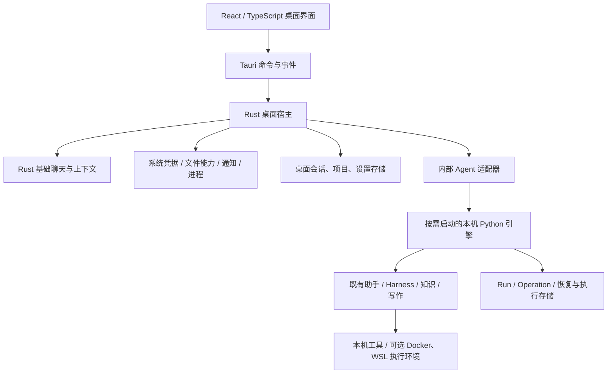

# 桌面端架构迁移与语言选型建议

分析日期：2026-11-09；源码基线：`df6d7e4`；实施状态：桌面主线迁移与旧产品入口清理已完成。

用户已明确：后续项目重心转向桌面端，旧 Web 服务不再继续维护。本文记录架构判断及已执行的迁移。首发目标为 Windows x64；其他操作系统按实际需求增加。

## 1. 建议结论

继续使用 **Tauri 2 + React/TypeScript + Rust** 构建桌面产品；保留 **Python 作为复杂 Agent 执行引擎**，改造为由桌面管理、随产品打包、按需启动的本机子进程。

普通聊天与少量项目材料问答继续走原生 Rust 路径，不要求启动 Python。多步任务、既有 RAG、写作与执行恢复复用 Python。长期只有一套复杂 Agent 编排内核，不在 Rust 再复制一套 Harness、Worker、预算和恢复状态机。

桌面是唯一正式产品入口。React 仍适合构建 Tauri 内的界面；开发时使用 Vite，不意味着继续交付浏览器产品。FastAPI 可以暂时作为内部通信适配层，停止对外提供 Web 产品，不要求立即删除内部 HTTP。

当前不建议全量改写 Rust，也不建议为统一语言更换 Electron、C# 或 Go。如果未来产品明确收缩为聊天、资料问答和轻量记忆，可以选择 Rust 主运行时、Python 仅保留离线评测；但这会放弃或另行迁移当前复杂助手能力，不能当作本次迁移的默认范围。

## 2. 当前架构事实

| 路径 | 实际实现 | 迁移含义 |
| --- | --- | --- |
| 原 Web | React → HTTP → FastAPI → Python 领域服务、Worker、SQLite | 浏览器入口可退役，Python 核心仍有复用价值 |
| legacy 桌面 | React → Tauri/Rust → `wsl.exe` → Python/FastAPI | 依赖源码路径、WSL 与 `.venv`，更接近开发环境连接器 |
| 原生聊天桌面 | React → Tauri commands → Rust ChatRuntime → Provider、SQLite、系统凭据 | 已有不依赖 Python/WSL 的基础产品路径 |

迁移前 `main.rs` 和前端入口同时选择原生聊天及 WSL 桌面路径，两个产品链路没有自动共享项目、会话、模型配置和任务状态。当前唯一入口为原生桌面；旧 WSL Rust 壳及浏览器 React 组件已删除。

Rust 聊天能力现拆分在 `desktop/src-tauri/src/chat/`，覆盖流式回复、取消、多会话、项目归类、SQLite 和系统凭据；复杂助手仍由 Python 引擎运行。桌面与引擎通过版本化本机 HTTP 协议及显式 Session 映射协作。

Python 的 `assistant`、`agent`、`execution`、`knowledge`、`writing` 等模块已有独立服务和测试；FastAPI 导入集中在 API、应用装配和桌面连接层。核心可复用，但启动/停止与初始化仍由 `application.py` 的 FastAPI lifespan 驱动，需要抽离。

## 3. 语言职责

| 层次 | 建议语言 | 职责 |
| --- | --- | --- |
| 桌面界面 | TypeScript + React | 聊天、项目导航、任务时间线、材料和记忆管理、设置 |
| 桌面宿主 | Rust | 窗口、托盘、系统通知、密钥、应用目录、文件能力、进程管理、升级 |
| 基础聊天 | Rust | 普通模型请求、流式输出、输入上下文选择、会话记录 |
| 复杂助手引擎 | Python | 策略、Harness、知识检索、写作、Run/Operation、预算、恢复、评测 |
| 桌面与引擎契约 | 版本化 Schema，生成 TS/Rust/Python 类型 | 命令、结果、错误、任务事件、能力与版本协商 |

Rust 比例随桌面系统功能增加；Python 从“独立 Web 后端”转为“内部执行引擎”。两种职责都需要维护，但无需维护两套同功能的 Agent。

不以语言数量本身作为优化指标。改写复杂内核会重新验证等待恢复、未知副作用、租约、预算和引用一致性；当前更直接的收益来自交付与职责收敛。模型网络延迟、上下文大小、检索与数据访问应先测量，不能预设换语言就会明显加速。

## 4. 目标架构



### 4.1 一个界面与一个任务入口

`DesktopChatApp` 是唯一界面；助手、写作、澄清和恢复动作已接入统一会话。旧 Web 页面、连接壳、API 客户端和专属组件已删除，不作为兼容产品维护。

前端通过统一 `DesktopClient` 访问业务，不在每个组件里判断浏览器或 Tauri，也不继续散布裸 `invoke` 和 HTTP 路径。桌面接口可以区分普通聊天与助手任务，但用户共用会话、项目导航和时间线。

Rust 桌面命令只验证输入并调用应用服务。核心 Rust 服务通过接口访问存储、凭据和事件，尽量不依赖 `AppHandle`，便于独立测试。

### 4.2 内部通信先复用，再按需要收敛

第一版优先复用已存在的内部 HTTP 路由与认证/实例校验，由 Rust 连接本机动态 loopback 端口。WebView 不直接持有后端令牌或请求 Python 服务。

现有 `/api/tasks/{run_id}/events?after=...` 已提供事件分页与 `next_cursor`；首轮由 Rust 按游标读取并转发到界面即可。以后确有延迟或复杂度收益时，再改成长连接或管道协议，不把换传输方式与首次能力接入捆绑。

协议至少包含版本、`request_id`、`session_id`、`run_id`、事件序号、错误代码与能力声明。聊天流也增加单次生成 ID；当前原生流主要依靠 `session_id` 区分，无法充分表达同一会话内取消后重新发送的事件归属。

持久化事件可按游标补发、去重；模型文字增量可以是临时显示。任务终态、人工动作与产物以持久化记录为准。不能把所有 SSE 字符增量都当作必须永久落库的任务事件。

### 4.3 数据按所有者分开，先不合库

| 数据 | 建议所有者 | 另一端的使用方式 |
| --- | --- | --- |
| 桌面项目、会话、显示消息、设置 | Rust 桌面应用 | 向引擎提供任务所需的固定上下文与关联 ID |
| Run、Operation、检查点、任务事件、知识索引 | Python 引擎 | 桌面通过接口读取事件与结果 |
| API Key | 系统凭据库，由 Rust 管理 | 启动/任务配置时通过私有通道向引擎提供所需凭据，不写入普通配置或日志 |
| 用户项目文件 | 原文件系统 | 依据显式能力授权访问，项目归类本身不授予读写或执行权限 |

每张业务表有唯一写入方，不让 Rust 与 Python直接修改对方数据库。桌面展示的任务结果是引擎结果的投影，用 `run_id` 和事件 ID 保证重复投递不会重复追加消息；任务事实仍由 Python 保存。

Python 现有 Session 仍参与队列、上下文和外键约束，不能直接删除。首轮建立桌面 Session 到引擎执行 Session 的显式映射，再增加固定输入快照适配：包括所需历史、项目材料版本、模型配置版本和授权引用。映射 ID 本身不会自动同步历史。引擎内部记录不成为第二份可独立编辑的用户会话，前端也不合并两份聊天记录列表。

初次任务接入应验证前几轮普通聊天确实进入所需任务上下文；不能只把最新问题发给一个空的 Python Session，就宣称实现了同会话协作。

### 4.4 WSL 变为可选执行环境

Windows 用户安装后应能直接聊天；启用复杂助手时，由程序启动打包的 Windows 原生 Python 引擎，无需选择发行版、填写仓库路径或自行创建虚拟环境。

WSL 可继续用于 Linux 项目工具，Docker 可继续用于隔离执行；二者均是可选能力。迁移 Python 到 Windows 不等于现有 Linux 容器、宿主 shell 和所有工具同时可用，应逐项报告能力状态。

| 已核对的代码位置 | 当前约束 | 调整建议 |
| --- | --- | --- |
| Rust 桌面入口和聊天存储 | 已拆分模块；默认只有原生桌面入口 | 维持 Rust 系统职责和聊天能力，不复制 Python Agent 内核 |
| 桌面 UI | React/TypeScript 位于 `desktop/ui`，没有浏览器分流 | 只通过 Tauri 原生客户端访问业务命令 |
| Python `ApplicationEngine` | 生命周期从 FastAPI 应用装配抽出 | 由 Rust 按需启动，FastAPI 只保留内部 loopback 适配 |
| Windows Python 引擎和 Tauri 配置 | PyInstaller one-file 随包分发，数据与资源路径显式注入 | 安装探针确认不依赖源码路径、系统 Python 或 WSL |
| 文件系统和工作区能力 | Windows 身份、只读属性、盘符和 junction 规则已加入平台适配 | 工作区必须显式登记；逐项说明 Docker/WSL 等运行能力 |
| Windows 构建及 CI | Windows 发布构建已包含 UI、Python 引擎和 Tauri 安装包；Ubuntu CI 覆盖 Python/UI 回归 | 后续可增加 Windows 自动构建 runner；本机安装探针仍是当前交付证据 |
| Python 目录布局 | `backend` 含本地环境和用户状态，不安全地直接改名 | 有独立备份与数据迁移方案后再考虑改为 `engine` |

Windows Python 使用 PyInstaller one-file 引擎随 Tauri 资源打包；资源定位、`tiktoken`、Unicode 路径、代理、生命周期及安装态启动已经通过对应的 Windows 探针验证。

## 6. 实施顺序与完成依据

### 阶段 A：桌面默认化与基础拆分（完成）

将默认开发、构建、运行和说明指向原生桌面；旧 Web 与 legacy WSL 路径先明确归档状态，不继续扩展。拆分 `chat.rs` 和前端业务访问层，修复历史窗口与上下文预算。

完成依据：默认命令生成原生聊天产品；在没有 WSL 和开发环境的 Windows 机器上可安装、启动、保存与恢复对话；长会话继续提问时最新问题进入模型请求。

### 阶段 B：Python 引擎脱离开发环境（完成）

抽出与 Web 无关的生命周期；提供显式应用目录和运行配置；打包 Windows 原生引擎；由 Rust 管理启动、健康、退出与崩溃状态。关闭窗口、退出应用和后台运行的语义分别定义，休眠后重新核对任务状态。

完成依据：安装目录外可运行；无系统 Python、源码 `.venv`、WSL 仍可启动只读能力；普通聊天不受引擎故障影响；旧任务状态不会因进程重启被误报成功。

### 阶段 C：接通复杂助手任务（完成）

从“在同一桌面会话中依据选定项目材料或既有知识回答，并可澄清、取消、恢复”开始。实现 Session/项目映射、输入快照、凭据配置、真实事件投影和幂等结果保存。使用原生文件读取或 Python 文件读取时，每个能力只选一个实际执行方，避免同时维护两套规则。

完成依据：普通聊天上下文能按规则进入任务；两项目不串用材料；取消与重新发送事件不串用；重开窗口可按游标恢复真实任务状态；引擎结果重投不重复生成消息。

### 阶段 D：迁入写作、修改与验证（完成本轮桌面接入）

继续使用既有 Python 编排，逐项适配本地/Docker/WSL 执行环境。代码修改与测试的权限、进程树、取消、未知副作用和产物验证单独验收。基础接入不要求同时重做所有领域内部恢复协议。

### 阶段 E：清理旧路径与交付收口（进行中）

桌面替代路径和旧数据导入通过后，再删除浏览器入口、旧浏览器发布说明、legacy 启动器和没有消费者的兼容代码。仍被桌面使用的内部 API 和领域回归继续维护。

原生聊天库与旧 `agent.db` 的表结构不同，不能直接复制或拼接。需要历史导入时，以停止写入后的备份或一致性快照为输入，记录导入来源/版本和 ID 映射，验证消息顺序、引用、项目路径与重复导入；旧目录必须重新定位与授权。旧 Run 的执行事实不转成新引擎可直接续跑的活动任务。

发布门禁随迁移调整：默认 Rust 目标就是唯一桌面产品，不再有 legacy feature 组合。保留基础聊天、引擎协议、历史库迁移和安装验证；工程测试不代替真实 Provider 资格验收。干净 Windows 用户和卸载后数据保留仍未验证。

## 7. 后续目录形态建议

当前 UI 已归入 `desktop/ui`，桌面宿主位于 `desktop/src-tauri`。Python 包仍保留在 `backend`，没有直接改名为 `engine`：该目录含约 529 MB 本地数据、虚拟环境及用户的 `.env` / TOML 配置。迁移这些本机状态需要单独备份与数据路径方案，不能作为旧 Web 清理的附带动作。后续代码结构可在本地数据迁移确定后再考虑：

```text
apps/desktop/
  ui/                   # React / TypeScript
  src-tauri/            # 窗口与命令适配
crates/desktop-core/    # Rust 应用服务、存储、Provider、系统接口
engine/
  core/                 # Python 领域服务与执行内核
  adapters/             # 内部 HTTP、桌面运行配置、工具平台实现
contracts/              # 版本化请求、结果和事件 Schema
evals/                  # 离线数据与评测入口
docs/
```

这不是要求现在拆成多个部署服务。桌面和按需子进程足以承载当前规模，暂不需要服务发现、消息中间件或分布式 Worker。

## 8. 本轮范围与源码依据

本轮已完成原生桌面默认化、Windows 打包引擎、任务/写作/恢复闭环及旧 Web/WSL 产品入口清理。使用独立应用标识完成 Windows 安装探针；没有读取或修改正式聊天库、真实 Provider 凭据或项目目录。表中的平台问题仍需逐项评估，不代表已经穷尽所有跨平台差异。

主要依据：

- [唯一 Rust 入口](../desktop/src-tauri/src/main.rs)、[原生聊天模块](../desktop/src-tauri/src/chat/)、[桌面 UI 入口](../desktop/ui/src/main.tsx)。
- [桌面聊天界面](../desktop/ui/src/desktop-chat/DesktopChatApp.tsx)、[原生客户端边界](../desktop/ui/src/desktop/client.ts)。
- [应用生命周期](../backend/app/application.py)、[依赖装配](../backend/app/dependencies.py)、[助手服务](../backend/app/assistant/service.py)、[Worker](../backend/app/execution/worker.py)。
- [任务事件 API](../backend/app/api/tasks.py)、[WSL 启动器](../backend/app/desktop/bootstrap.py)、[路径配置](../backend/app/settings.py)。
- [Windows 构建脚本](../desktop/scripts/windows.ps1)、[当前 CI](../.github/workflows/verification.yml)。
- [既有项目深化分析](项目深化方向分析.md)、[Windows 桌面说明](../desktop/README.md)。既有文档中仍可能包含 Web 维护和 WSL 主入口的历史建议，本次用户确定的桌面方向优先。
